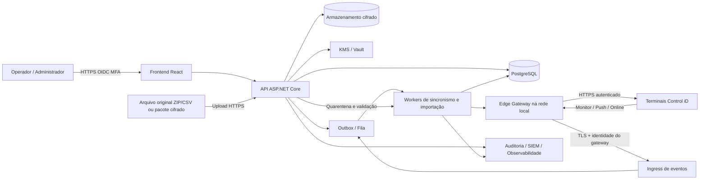
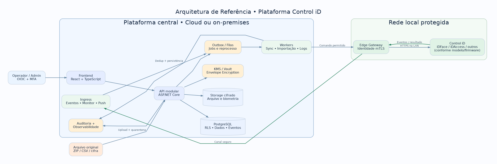

<!-- DOCUMENTO CONSOLIDADO · Todas as seções também estão no ZIP em arquivos individuais. -->

# Plataforma de Integração Control iD — Blueprint de Engenharia

**Versão do blueprint:** 1.0 · **Data:** 05/11/2026 · **Status:** especificação para implementação, **não** software implementado ou compatibilidade homologada.

## Objetivo

Construir uma plataforma web segura, auditável, multiunidade e preparada para múltiplos clientes (tenants), com **PostgreSQL como banco operacional**, capaz de absorver e gerenciar dados dos equipamentos de **controle de acesso** Control iD tanto **pela API do equipamento** quanto **por arquivos exportados**, operar regras de acesso, acompanhar eventos, administrar dispositivos e produzir relatórios. O sistema deverá ser simples para operadores comuns, sem perder profundidade de administração.

> **Escopo verificado:** a documentação referenciada é a **API Linha de Acesso**, e não necessariamente todas as famílias de produtos Control iD (por exemplo, APIs de REP/ponto podem ser diferentes). 'Integração completa' significa cobrir todas as capacidades **expostas, relevantes e testadas** para cada modelo e firmware, e não prometer funções indisponíveis em um hardware. O desenvolvimento tem de manter uma **matriz de compatibilidade por dispositivo/firmware**.

## Recomendações executivas

1. **Stack:** ASP.NET Core sobre versão .NET LTS suportada no início do desenvolvimento (baseline proposta: .NET 10 LTS, a validar no ambiente) + PostgreSQL 16+ + React/TypeScript + Vite + TanStack Query + componentes acessíveis (Radix/shadcn) + Redis opcional + fila durável (RabbitMQ ou PostgreSQL outbox/queue para a primeira instalação) + S3 compatível/MinIO para blobs cifrados.
2. **Arquitetura:** *modular monolith* com workers e conectores de dispositivo isolados. Não começar com uma dúzia de microsserviços. Módulos: identidade/tenancy, cadastro, regras, dispositivos, sincronismo, ingestão de arquivos, eventos, autorização, relatórios, auditoria, chaves e operações.
3. **Conectividade:** **Edge Gateway** (agente instalado próximo dos equipamentos) para LANs sem acesso direto a partir do servidor; saída VPN/TLS. **Nunca expor a API administrativa da catraca/terminal na Internet**.
4. **Modo padrão:** **Standalone**, recomendado pelo fabricante, com sincronização de cadastros e políticas + Monitor para eventos. Pro opcional quando for necessária autorização online. Enterprise só com motor biométrico homologado e análise legal; **não basta receber uma imagem para identificar uma pessoa**.
5. **Sincronização:** estado desejado no PostgreSQL + reconciliador idempotente por equipamento + registros de aplicação e verificação; eventos via Monitor + *backfill* por `load_objects`, e Push conforme topologia. Arquivos entram na **mesma camada de normalização**, mas não são enviados de volta ao aparelho como um ZIP refeito.
6. **Importação criptografada:** TLS durante trânsito, criptografia autenticada AES-256-GCM em repouso e exportações, envelope encryption DEK/KEK, KMS/Vault, opção de pacote cifrado com senha (Argon2id) ou chave pública (HPKE implementado por biblioteca mantida). Upload em quarentena, antivírus, limites contra ZIP bomb, mapeamento, prévia e aprovação de *diff*.
7. **Biometria:** dado sensível; ativar o módulo apenas quando necessário, com política própria, acesso restrito, retenção curta, segregação de chaves e sem reexibir templates em telas comuns.
8. **Ação física:** abertura remota e mudanças que afetam segurança precisam de autorização própria, confirmação, motivo, trilha de auditoria, limites, rate limiting e dupla aprovação onde apropriado. A API pode confirmar o comando sem comprovar que a pessoa atravessou o portal.

## Desenho da solução





## Conteúdo do pacote

| Documento | Entregável |
|---|---|
| `docs/01-escopo-requisitos.md` | Escopo, perfis, RF, RNF, critérios de aceite |
| `docs/02-arquitetura.md` | Componentes, topologias, sincronização, decisões |
| `docs/03-catalogo-api.md` | Objetos, endpoints, matriz de cobertura e limitações |
| `docs/04-importacao.md` | Importação API/arquivos, criptografia, reconciliação e UX |
| `docs/05-dados.md` | Modelo lógico, regras SQL, retenção e performance |
| `docs/06-seguranca.md` | Ameaças, KMS, LGPD, proteção da API e operação física |
| `docs/07-ux.md` | Fluxos, telas, design system, erros e acessibilidade |
| `docs/08-qualidade.md` | Testes, SLIs/SLOs, carga, resiliência e entrega |
| `docs/09-plano-execucao.md` | Fases, épicos, dependências, DoR/DoD e prioridades |
| `docs/10-skills.md` | Skills reais e skills específicas propostas para agentes |
| `docs/11-operacao.md` | Runbooks, backups, reversão, incidentes e manutenção |
| `docs/12-contratos.md` | API interna, eventos, exemplos e semântica de erros |
| `docs/13-validacoes.md` | Questões que dependem de hardware, firmware e negócio |
| `docs/14-rastreabilidade.md` | Cobertura por origem e regra de homologação |
| `docs/15-prompt-construcao.md` | Instruções diretas para equipe ou agente de engenharia |
| `sql/001_init.sql` | Esquema inicial PostgreSQL executável como ponto de partida |
| `diagrams/*.mmd` | Diagramas Mermaid de arquitetura e sequência |
| `diagrams/arquitetura.png` | Arquitetura visual pronta para apresentar |
| `skills/*/SKILL.md` | Skills personalizadas para a implementação |
| `examples/` | Exemplos de manifesto cifrado e payloads |
| `AGENTS.md` | Regras do repositório para agentes de desenvolvimento |

## Restrições obrigatórias

- **Não** fazer acesso Control iD diretamente do browser; chamadas a equipamentos somente via servidor/Edge com TLS, ACL e sessão gerenciada.
- **Não** atribuir um mesmo ID de usuário do equipamento a pessoas diferentes no mesmo equipamento; usar ID interno UUID e tabela de vínculos por terminal.
- **Não** fazer merge automático por nome, nem apagar usuário porque faltou no arquivo.
- **Não** guardar segredo, PIN, senha de equipamento, payload biométrico ou URL com `?session=` em logs.
- **Não** aceitar arquivos gigantes sem limites de tamanho/tempo/compactação e sem verificação do conteúdo.
- **Não** enviar ZIP de backup alterado aos terminais: a Control iD alerta para não modificar manualmente seus formatos de exportação.
- **Não** prometer suporte a todos os modelos sem uma *suite* de testes por modelo/firmware.

## Bibliografia oficial e padrões

- Control iD API de Acesso: https://www.controlid.com.br/docs/access-api-pt/
- Objetos da API: https://www.controlid.com.br/docs/access-api-pt/objetos/lista-de-objetos/
- Importar/exportar: https://www.controlid.com.br/docs/access-api-pt/sistema/sincronizacao/
- Monitor: https://www.controlid.com.br/docs/access-api-pt/monitor/introducao-ao-monitor/
- Push: https://www.controlid.com.br/docs/access-api-pt/modo-push/introducao-ao-push/
- Modos: https://www.controlid.com.br/docs/access-api-pt/modos-de-operacao/introducao-aos-modos-de-operacao/
- Eventos online: https://www.controlid.com.br/docs/access-api-pt/modos-de-operacao/eventos-de-identificacao-online/
- Face: https://www.controlid.com.br/docs/access-api-pt/reconhecimento-facial/cadastro-facial/
- Hardening iDFace: https://www.controlid.com.br/manual/security-hardening-guide-en.pdf
- OWASP ASVS 5.0.0: https://asvs.owasp.org/
- OWASP Cryptographic Storage: https://cheatsheetseries.owasp.org/cheatsheets/Cryptographic_Storage_Cheat_Sheet.html
- OWASP File Upload: https://cheatsheetseries.owasp.org/cheatsheets/File_Upload_Cheat_Sheet.html
- ANPD, incidentes: https://www.gov.br/anpd/pt-br/canais_atendimento/agente-de-tratamento/comunicado-de-incidente-de-seguranca-cis
- Agent Skills spec: https://github.com/agentskills/agentskills

**Leitura obrigatória antes da primeira sprint:** `docs/13-validacoes.md`. O que não foi confirmado em equipamento real deve ficar rotulado como **proposta, a homologar**, inclusive SLA, licença de modo online, formato exato de CSV, mecanismos de TLS e suporte de cada endpoint.


---

# 01 — Visão de produto, requisitos e critérios de aceite

## Escopo de produto

**Produto:** Control iD Integration Hub (nome provisório), painel de controle de acesso multiunidade com ingestão híbrida. A aplicação **não substitui automaticamente** o firmware, leitor biométrico ou regras críticas do terminal. Ela funciona como cadastro mestre e plataforma de observabilidade/orquestração, respeitando o modo de operação.

**Principais atores:** Proprietário da plataforma; administrador do tenant; supervisor de segurança; operador de portaria; encarregado de privacidade; auditor (somente leitura); técnico de integração; gestor de unidade; job de sincronização; terminal; gateway local. Cada papel usa permissões por ação + escopo por unidade/porta (RBAC + ABAC); 'administrador' não significa permissão de biometria e abertura remota irrestritas.

**Domínios funcionais:** gestão de organizações/unidades; equipamentos/portas/catracas; pessoas/visitantes; documentos e credenciais; grupos/departamentos; áreas/portais; janelas e horários; regras de permissão/bloqueio; feriados; controle da sincronização; logs de acesso/alarme; operação remota controlada; importação/exportação; biometria e fotos (módulo opcional); atendimento a titular; dashboards; auditoria; relatórios; manutenção.

## Histórias e requisitos rastreáveis

| ID | Requisito funcional | Prioridade | Aceite objetivo |
|---|---|---|---|
| RF-001 | Autenticação SSO/OIDC e MFA de perfis privilegiados | P0 | Sessões seguras, MFA exigido e tentativas registradas |
| RF-002 | Cadastro de tenant, unidade, área física | P0 | Dados isolados, com scoping por unidade |
| RF-003 | Registrar equipamentos manualmente com IP, modelo, firmware, série, modo e credencial protegida | P0 | Segredo não aparece depois de salvo |
| RF-004 | Teste de conectividade autenticado | P0 | Exibe alcance, TLS, login, relógio, capacidades e erros separados |
| RF-005 | Inventário e histórico de configurações aprovadas | P1 | Detecta drift, mostra diff, propõe correção |
| RF-006 | Cadastro de pessoa, matrícula, vigência, fotos, credenciais | P0 | ID interno independente do ID do terminal |
| RF-007 | Vincular pessoa a 0..N dispositivos | P0 | Mapeamento device/user_id local persistente |
| RF-008 | Cadastro de visitantes com expiração | P1 | Revogação agendada e conferida |
| RF-009 | Grupos/departamentos | P0 | Sincronizam e preservam relações |
| RF-010 | Áreas, portais e direção | P0 | Grafo válido sem referências quebradas |
| RF-011 | Regras de acesso e vínculos | P0 | Bloqueio prevalece sobre permissão conforme dispositivo |
| RF-012 | Intervalos semanais e feriados | P0 | Timezone explícito e simulação cobre meia-noite |
| RF-013 | Importação por API `load_objects` | P0 | Paginação, checkpoints e reconciliação auditada |
| RF-014 | Importação de arquivo `users` | P0 | ZIP original preservado, versão identificada, preview |
| RF-015 | Importação de logs | P0 | CSV ingerido sem duplicar eventos |
| RF-016 | Importação `sync` / `backup` | P0/P1 | Parse validado por V5/V6 e política de domínio |
| RF-017 | Arquivo criptografado | P0 | Criptografia autenticada, falha fechada em adulteração |
| RF-018 | Importação assistida | P0 | Mapeamento, validação, diferenças, aprovação e commit |
| RF-019 | Exportação criptografada pelo sistema | P0 | Chaves, integridade, manifesto e expiração documentados |
| RF-020 | Registro do arquivo bruto imutável | P0 | SHA-256, origem, autor, timestamps e status |
| RF-021 | Sincronização `create/modify/destroy` | P0 | Preview do diff e retry sem duplicação |
| RF-022 | Monitor de logs e estado | P0 | Eventos autenticados persistidos com dedup |
| RF-023 | Reconciliação de lacunas de evento | P0 | Backfill via API após queda de rede |
| RF-024 | Push pull de comandos | P1 | Comandos allowlist assinados, resposta correlacionada |
| RF-025 | Modo Standalone | P0 | Não depende da latência do servidor para acesso |
| RF-026 | Modo Pro | P1 | SLO de decisão, mecanismo de contingência testado |
| RF-027 | Modo Enterprise | P2/condicional | Só com engine biométrico/licenciamento homologados |
| RF-028 | Cadastro de fotos com proteção LGPD | P1 | Acesso por papel, formato e retenção definidos |
| RF-029 | Cadastro biométrico remoto quando suportado | P1 | Fluxo consentimento/base legal e status rastreado |
| RF-030 | Suporte de cartão, QR, UHF, PIN conforme equipamento | P1 | Feature flags por hardware e modo |
| RF-031 | Comandos físicos (`execute_actions`) | P1 | Confirmação + motivo + autorização + auditoria |
| RF-032 | Ver estado de porta/catraca/alarmes | P1 | Data/hora do último sinal claramente exibida |
| RF-033 | Desativar pessoa/credencial | P0 | Revogação propagada/pendente visível por equipamento |
| RF-034 | Dashboard de saúde | P0 | Online, offline, fila, divergências e último evento |
| RF-035 | Pesquisa de eventos | P0 | Filtro por pessoa/porta/período/causa/política |
| RF-036 | Relatórios CSV/XLSX/PDF | P1 | Export control, minimização e trilha |
| RF-037 | Auditoria central | P0 | Quem, o quê, onde, quando, motivo, resultado, correlação |
| RF-038 | Direito do titular / eliminação | P1 | Workflow com exceções de retenção legais documentadas |
| RF-039 | Backup e restauração | P0 | Restore periódico demonstrado |
| RF-040 | Multiunidade com perfil por unidade | P0 | IDOR entre unidades impedido |
| RF-041 | Alertas de falha, porta aberta, dispositivo offline | P1 | Roteamento, dedup, resolução e política de ruído |
| RF-042 | Modo de simulação de política | P1 | Mostra por que um acesso seria permitido/negado |
| RF-043 | Histórico de tentativas de sincronização | P0 | Etapas/causas por objeto e dispositivo |
| RF-044 | Importação dry-run sempre disponível | P0 | Não altera dados ou comandos físicos |
| RF-045 | Separação de perfis de consulta e operação perigosa | P0 | ABAC impede elevação implícita |
| RF-046 | Arquivamento por retenção e descarte seguro | P1 | Logs de expurgo e política por categoria |
| RF-047 | Compatibilidade V5/V6 | P0 | Amostras reais passam testes de regressão |
| RF-048 | Auditoria de drift das configurações | P1 | Captura diferenças, sem auto-sobrescrever sem política |
| RF-049 | Gestão de segredos e rotação | P0 | KMS/Vault, trilha e rotação testadas |
| RF-050 | Alertar tempo incorreto do terminal | P0 | Divergência, timezone e NTP exibidos |

**Fora do escopo inicial:** desenvolver algoritmo proprietário de reconhecimento facial; manter banco central de biometria sem necessidade legal comprovada; expor acesso público aos equipamentos; firmware customizado; alterar automaticamente configuração de rede em produção; reproduzir interfaces nativas 1:1; integração com ponto/REP sob a premissa de que compartilha a API Linha de Acesso.

## Casos de uso end-to-end

1. **Conectar aparelho:** técnico cria unidade, instala gateway, registra aparelho, cadastra credencial via cofre, verifica certificado, consulta versão/modo, identifica módulos suportados, habilita Monitor/Push com assistente de configuração e gera relatório de conectividade.
2. **Importar base histórica:** operador carrega ZIP/CSV ou pacote cifrado, valida, vê diferenças, concilia conflitos, solicita aprovação, confirma, acompanha job e obtém relatório de itens importados/ignorados/quarentenados.
3. **Sincronizar pessoas e regras:** mestre altera pessoa → outbox transacional → cálculo de diff → filas por dispositivo → job aplica em ordem topológica → readback verifica → mostra sucesso ou pendência.
4. **Acompanhar eventos:** ingress recebe eventos, autentica equipamento, grava entrada idempotente, normaliza, vincula pessoa e equipamento, aciona alertas; reconciliação preenche lacunas.
5. **Revogar credencial:** supervisor clica revogar; sistema registra urgência, invalida autorização central de imediato (Pro) e envia revogação ao aparelho (Standalone); status fica **pendente** até confirmação local; alerta se persistir.
6. **Abrir porta remotamente:** operador habilitado seleciona porta, informa motivo, confirma a ação, sofre checagem de política e de estado, sistema comanda e registra; interface distingue 'comando enviado' de 'porta efetivamente aberta'.

## Critério de conclusão da plataforma

A 'integração completa' é considerada demonstrada **por firmware e modelo**, com um mapa de endpoints e objetos testados, incluindo: autenticação; CRUD de objetos suportados; fotos/credenciais aplicáveis; importação/exportação de arquivos; eventos Monitor; Push se ativado; modo online quando licenciado; comandos físicos autorizados; comportamento offline e contingência. Funções não suportadas serão desabilitadas visualmente com explicação e sem chamadas de tentativa às cegas.


---

# 02 — Arquitetura técnica de referência

## Decisão principal: monólito modular + workers + gateway

**Por quê:** requisitos de isolamento, autorização, auditoria e transações consistentes são mais importantes que independência de deploy por módulo no primeiro ciclo. Fragmentar em dezenas de serviços aumenta superfície de ataque, telemetria e integração. Separe por **limites de domínio** e por **processos de operação** (API, workers, gateway).

### Bounded contexts

- `IdentityTenancy`: usuários operadores, OIDC, organizações, unidades, permissões.
- `People`: pessoas, visitantes, vínculo externo e expiração.
- `Credentials`: cartões, PIN, QR, UHF, fotos/templates (biometria em compartimento isolado).
- `AccessPolicy`: áreas, portais, grupos, horários, feriados, políticas, simulação e mudanças.
- `Fleet`: inventário de terminais, firmware, perfil de capacidade, health, certificado, segredos por dispositivo.
- `Sync`: estado desejado/observado, transformações, outbox, distribuição e reconciliação.
- `Ingestion`: conexões com API, importação e exportação por arquivo, paridade V5/V6.
- `Events`: entrada Monitor/Push/Online, normalização, replay, métricas e incidentes.
- `PhysicalActions`: comandos de portas, catracas e SecBox, autorizações excepcionais.
- `Governance`: políticas de retenção, logs de auditoria, titular, backups e relatórios.

### Interfaces e execução

- **Frontend:** React + TypeScript, Vite, TanStack Router/Query, componentes acessíveis; autenticação via backend-for-frontend e cookies HttpOnly Secure/SameSite, nunca token do dispositivo no browser.
- **Backend:** ASP.NET Core modular, contratos OpenAPI, validações no domínio, autenticação OIDC, autorização RBAC/ABAC, DTOs imutáveis e versionados, DI e testes.
- **DB:** PostgreSQL 16+ com migrações, RLS onde aplicável, JSONB para payloads normalizados não canônicos, particionamento de eventos, índices por tenant/dispositivo/tempo.
- **Workers:** `ImportWorker`, `SyncWorker`, `BackfillWorker`, `ReportWorker`, `RetentionWorker`, `AlertWorker`. Podem coexistir em um único executável com filas separadas; escalar processos sem criar APIs extras.
- **Fila:** implementar primeiro **transactional outbox** no PostgreSQL + worker de polling/`SKIP LOCKED` e dedup; adotar RabbitMQ se carga, fan-out ou topologias exigirem. Não deixar Redis sozinho ser fonte durável dos comandos.
- **Storage:** S3 compatível, bucket privado com objetos criptografados e versão/lifecycle; metadados no PG, nunca fotos/ZIP grandes no banco operacional.
- **Segredos:** Vault/KMS sob service identity; envelope encryption, rotação; um papel diferente para cada worker/serviço.
- **Edge Gateway:** serviço .NET Worker/Windows Service/Linux container numa rede confiável próxima ao hardware. Descoberta apenas no CIDR aprovado, saída TLS/VPN, identidade por certificado ou credencial curta, spool local **cifrado** com limite/TTL, fila de tarefas assinadas/identificadas.
- **Observabilidade:** OpenTelemetry + Prometheus/Grafana + Loki/tempo ou equivalente; redigir campos sensíveis na origem. Auditoria de negócio independente de logs técnicos.

## Topologias aprovadas

**A. Local/on-premises:** Front/API/DB/Storage/Workers hospedados na mesma LAN privada ou rede corporativa segmentada, equipamentos em VLAN própria, firewall L3 permit-list. Adequada a ambientes onde dados biométricos não podem sair da empresa.

**B. SaaS híbrido (preferida para múltiplos clientes):** API/Web/PG/cofre em nuvem; gateway por cliente/unidade em LAN; conexão de **saída** do gateway ao serviço por mTLS ou túnel; equipamento **nunca** recebe conexão inbound da Internet. Eventos que terminal envia diretamente ao monitor podem apontar ao gateway local. Gateway encaminha com autenticação, replay protection e payload mínimo.

**C. VPN site-to-site:** central pode acessar dispositivos por rotas privadas; ainda preferir gateway quando rede heterogênea ou clientes não aceitarem rotas. Verificar se HTTPS do modelo realmente está disponível, sem desabilitar validação de certificado.

### Isolamento multi-tenant

Toda tabela de negócio possui `tenant_id`; cada consulta e comando carrega contexto confiável extraído do principal autenticado e usa escopo em repositório + política RLS quando aplicável. Identificadores externos (`device_id`, `user_id`, `portal_id`) são **escopados ao terminal** e não únicos globalmente. Storage usa prefixo por tenant + autorização no serviço, não só no path. Chave criptográfica por tenant para dados mais sensíveis. No início, single-db/shared-schema com RLS; opção de banco separado para clientes regulados. Contas de migração e aplicação diferentes.

### Fluxos de rede

| Origem | Destino | Canal | Objetivo | Restrição |
|---|---|---|---|---|
| Browser | BFF/API | HTTPS | Operação | CSP, OIDC/MFA, cookie seguro, CSRF |
| API | PG | TLS rede interna | Persistência | role least privilege |
| API/worker | KMS | TLS/mTLS | Chaves | service identity, sem log de segredo |
| API/worker | Storage | TLS | Arquivos cifrados | bucket privado, sem public-read |
| Worker central | Gateway | TLS/mTLS ou stream iniciado pelo Edge | Tarefas | escopo tenant/site; comando TTL |
| Gateway | Terminal | HTTPS (suportado) | API da linha de acesso | VLAN, validação certificado, IP allowlist |
| Terminal | Gateway | HTTPS/segmentado | Monitor/Push/Pro | endpoints estritos e autenticados |
| Gateway | Ingress central | TLS/mTLS | Eventos | nonce/UUID, dedup, limitação de taxa |

**Atenção:** o hardware e firmware poderão não suportar o método de autenticação desejado para callbacks. Quando faltarem bearer/pin de certificado, compensar com VLAN restrita, VPN/gateway, IP allowlist, proteção contra spoofing de `device_id`, e documentar o risco residual. Não presumir que o campo `device_id` sozinho autentica a origem.

## Mecanismo de sincronismo

**Fonte de verdade:** campo a campo, por domínio, configurável; recomendado: Pessoas/credenciais/grupos/regras — plataforma mestre após importação inicial; eventos — terminais; configurações críticas — terminal + change request explícita. Never blind bidirectional overwrite.

**Modelo:** `desired_state` e `observed_state`, hash canônico por entidade/relação, `sync_change` por aparelho, `sync_run` com checkpoint. Algoritmo: detectar divergências -> DAG de dependências -> calcular ações em lote pequeno -> verificar precondições -> gravar outbox -> enviar -> registrar ACK -> readback quando disponível -> atualizar status. Operações 'delete' sempre dependem de política de negócio, tombstone e período de segurança.

**Ordem típica:** grupos/áreas/horários/feriados -> usuários -> regras -> vínculos -> cartões/QR/UHF/PIN -> fotos/templates (se habilitados) -> validação. O grafo real deve ser determinado pelas FKs/semântica observadas nos equipamentos. Exclusões precisam de ordem inversa e verificação.

**Backfill de eventos:** manter `(tenant_id, device_id, object, source_id)` único; ler `access_logs` com `id > cursor` paginado e `order id`; no boot/queda, reconciliar por sobreposição temporal/ID, sem supor ID contínuo ou nunca reciclado. Ao detectar reset/contador regressivo, iniciar `source_epoch` novo e validar via assinatura do dispositivo/firmware para impedir falso dedup. Monitor permite baixa latência; polling repara perdas.

**Clock:** salvar `device_timestamp_raw`, `observed_at`, `ingested_at`, timezone do site e *clock_skew* estimado; jamais corrigir timestamps e destruir origem. O relógio deve usar NTP confiável. Detectar timezone diferente ou ajustes de verão.

**Concorrência:** 1 fila de mutações serializada por equipamento; eventos em paralelo com limite; ações físicas de alta prioridade em fila separada com TTL muito curto e gate de autorização. Lock distribuído por equipamento e fencing token; timeout, circuit breaker, exponential backoff com jitter, dead-letter, relatório de causa, reprocesso manual. Não fazer retry cegamente de abertura física (comando não idempotente).

## ADRs iniciais

- ADR-001 PostgreSQL como fonte canônica; blobs grandes fora do PG.
- ADR-002 Modular monolith; interfaces de módulo internas explicitamente versionadas.
- ADR-003 Gateway edge para instalações remotas; comunicação pública somente outbound.
- ADR-004 Standalone primeiro; Pro depois; Enterprise condicionado a homologação.
- ADR-005 Dados do dispositivo não são ID global. Usar UUID central + tabela de vínculos.
- ADR-006 Separar histórico de eventos de intenção de liberar acesso.
- ADR-007 Importação é pipeline com `dry-run` e aprovação, não upload-que-grava.
- ADR-008 Criptografia com AEAD + chaves segregadas; nenhum algoritmo caseiro.
- ADR-009 Permissões negativas prevalecem; RBAC + escopo físico.
- ADR-010 Priorizar restrição de rede e proteção física, mesmo com custo operacional adicional.


---

# 03 — Catálogo Control iD e matriz de integração

**Fonte de referência:** https://www.controlid.com.br/docs/access-api-pt/ . Este inventário reúne **interfaces documentadas da Linha de Acesso**, não uma afirmação de que todas funcionam em todos os modelos/firmwares. Criar em banco uma **capability matrix** cuja chave seja `(model, firmware, feature)` e registrar evidência (requisição/resposta saneada, hardware, data, teste). Um endpoint não homologado deve ser apresentado como 'não validado', nunca como operacional.

## Protocolo e comportamento

- API HTTP(S) baseada em `POST /...fcgi`, majoritariamente JSON; exceções binárias, URL encoded e `GET /push`.
- `POST /login.fcgi` retorna `session`; sessão reaproveitada nas chamadas autenticadas. Armazenar só no backend em memória/cofre com TTL, sem logar a URL com `?session=`. Renovar quando expirar, fazer logout quando possível.
- Alguns manuais/exemplos mostram HTTP, senhas default e sessão em query string; **não** reproduzir defaults em produção. Habilitar HTTPS e validação de certificado quando suportados; remover sessão de telemetria de URL, traces e proxies.
- `load_objects` suporta filtros, projeções, paginação `limit`/`offset`, ordenação; validar inconsistências de paginação/ordenação; mapear IDs int64 para `BIGINT` (com cuidado em JavaScript acima de 2^53).
- Operações modificadoras não são necessariamente idempotentes; dar **idempotência no orquestrador** por intenção e confirmação com readback. `create_or_modify_objects` é upsert condicionado à semântica do `id`, não substitui transação distribuída.

## Endpoints operados pelo servidor contra o terminal

| Capacidade | Método/endpoint | Enfoque de implementação | Homologação |
|---|---|---|---|
| Login | `POST /login.fcgi` | sessão reutilizada e protegida | Por hardware |
| Validade de sessão | `POST /session_is_valid.fcgi` | pode ter semântica distinta no callback online | Por hardware |
| Logout | `POST /logout.fcgi` | limpeza da sessão | Por hardware |
| Consultar objetos | `POST /load_objects.fcgi` | filtros, paginação, projeções | Essencial |
| Criar | `POST /create_objects.fcgi` | lotes pequenos e readback | Essencial |
| Alterar | `POST /modify_objects.fcgi` | predicado específico, optimistic check | Essencial |
| Criar ou atualizar | `POST /create_or_modify_objects.fcgi` | id explicitamente mapeado | Essencial |
| Excluir | `POST /destroy_objects.fcgi` | bloqueio de delete irrestrito | Essencial |
| Exportar CSV estruturado | `POST /export_objects.fcgi` | seleção de objetos/colunas | Essencial |
| Relatório | `POST /report_generate.fcgi` | exportação conforme campos | Por firmware |
| Leitura de configurações | `POST /get_configuration.fcgi` | capturar perfil mínimo | Essencial |
| Alterar configurações | `POST /set_configuration.fcgi` | diff/aprovação e backup | Essencial |
| Hash senha de usuário do terminal | `POST /user_hash_password.fcgi` | não confundir com Argon2id da aplicação | Condicional |
| Upload foto | `POST /user_set_image.fcgi` | `octet-stream`, limite/documentação | iDFace |
| Upload fotos em lote | `POST /user_set_image_list.fcgi` | payload máximo de 2 MB | iDFace |
| Ler imagem/listar timestamps | `user_get_image.fcgi`, `user_list_images`, `user_get_image_list` | conferir contrato exato no firmware | Condicional |
| Remover imagem | `user_destroy_image.fcgi` | política de exclusão | Condicional |
| Cadastro remoto | `remote_enroll.fcgi` | notificação do Monitor, credenciais | Condicional |
| Carga biométrica em massa | `template_sync_init.fcgi`, `template_sync_end.fcgi` | orquestrar janela de carga | Condicional |
| Abrir porta/catraca | `POST /execute_actions.fcgi` | comando físico autorizado | Por hardware |
| Consultar estado | `door_state.fcgi` / `doors_state.fcgi` | documentação apresenta divergência singular/plural: **testar** | Por hardware |
| Status/reinício/rede/hora | `system_information.fcgi`, `reboot.fcgi`, `set_system_time.fcgi`, `set_system_network.fcgi` | conferir seção de sistema por firmware; rede/reboot em manutenção | Por firmware |
| Reset fábrica | `reset_to_factory_default.fcgi` (onde suportado) | **bloqueado por padrão**, aprovação offline | Alto risco |

**Limites conhecidos:** fotos do iDFace podem ser enviadas em JPEG e cadastro individual requer `application/octet-stream`; a documentação indica **menos de 2 MB para foto individual** e **até 2 MB por payload de lista**. Para fotos, há configuração `keep_user_image=0` que evita armazenar a imagem depois da criação do template facial, mas confirmar efetividade e implicações de retenção no firmware. Fontes: https://www.controlid.com.br/docs/access-api-pt/reconhecimento-facial/cadastro-facial/ .

## Endpoints que **nossa plataforma** precisa oferecer ao terminal

| Origem / modo | Rota recebida | Tratamento |
|---|---|---|
| Monitor | `POST /api/notifications/dao` | mudanças em `access_logs`, `templates`, `cards`, `alarm_logs` |
| Monitor | `POST /api/notifications/usb_drive` | auditoria USB |
| Monitor | `POST /api/notifications/template` | enrollment remoto biometria |
| Monitor | `POST /api/notifications/user_image` | enrollment remoto foto |
| Monitor | `POST /api/notifications/face_template` | enrollment remoto facial |
| Monitor | `POST /api/notifications/card` | enrollment de cartão |
| Monitor | `POST /api/notifications/pin` | enrollment PIN |
| Monitor | `POST /api/notifications/password` | enrollment senha |
| Monitor | `POST /api/notifications/catra_event` | giro/desistência catraca |
| Monitor | `POST /api/notifications/operation_mode` | modo/contingência |
| Monitor | `POST /api/notifications/device_is_alive` | heartbeat Standalone |
| Monitor | `POST /api/notifications/door` | sensor/relé |
| Monitor | `POST /api/notifications/secbox` | relé da security box |
| Monitor | `POST /api/notifications/access_photo` | foto de tentativa, **opt-in** e retenção restrita |
| Push | `GET /push` | pull comandos, resposta vazia se ocioso |
| Push | `POST /result` | resultado, `uuid`, `deviceId`, correlação e erros |
| Online | `POST /session_is_valid.fcgi` | handshake online conforme configuração |
| Online | `POST /device_is_alive.fcgi` | recuperação de contingência |
| Online Pro | Eventos de identificação por ID | resposta de permissão, formato exato por evento |
| Online Enterprise | `new_biometric_image.fcgi`, `new_biometric_template.fcgi` | **somente com motor de reconhecimento homologado** |
| Online Enterprise | `new_card.fcgi`, `new_qrcode.fcgi`, `new_uhf_tag.fcgi` | entradas com payload próprio, não sempre JSON |
| Online | `new_rex_log.fcgi` | ação de botoeira |

> **Importante:** Roteamento real deve respeitar `hostname`, `port` e `path` configurados no Monitor/Push, inclusive prefixos no gateway. Consultar o documento completo dos eventos online para demais tipos e mensagem de retorno. Respostas vazias/OK e tempos limite têm significado funcional; não retornar um JSON genérico para tudo.

## Catálogo de objetos da documentação — estrutura de domínios

O aplicativo deve manter **um adapter de importação/exportação para todos os objetos abaixo**. Para cada um: chaves, relações, tipos, campos sensíveis, capacidades `read`, `create`, `modify`, `delete`, dependências, disponibilidade por firmware, regra de normalização e round-trip. **Nem todo objeto precisa de uma tela de CRUD própria.**

| Família | Objetos da API (nome literal) | Módulo local |
|---|---|---|
| Pessoas e privilégios | `users`, `user_roles`, `groups`, `user_groups`, `change_logs` | People / Sync |
| Credenciais | `templates`, `cards`, `qrcodes`, `uhf_tags`, `pins`, `contingency_cards`, `contingency_card_access_rules` | Credentials |
| Acesso e espaços | `areas`, `portals`, `portal_actions`, `access_rules`, `portal_access_rules`, `group_access_rules`, `user_access_rules`, `area_access_rules`, `scheduled_unlocks`, `scheduled_unlock_access_rules` | AccessPolicy |
| Horários e feriados | `time_zones`, `time_spans`, `access_rule_time_zones`, `holidays` | AccessPolicy |
| Alarmes | `alarm_zones`, `alarm_zone_time_zones`, `alarm_logs`, `timed_alarms` | Events |
| Eventos | `access_logs`, `access_log_access_rules`, `access_events`, `log_types` | Events |
| Equipamentos/integração | `devices`, `catra_infos`, `sec_boxs`, `network_interlocking_rules` | Fleet |
| Telefonia/quiosque | `contacts`, `contact_groups`, `contact_contact_groups`, `kiosk_buttons` | Extensions |
| Recursos condicionais | `custom_thresholds` e campos/objetos adicionais detectados em firmware | Facial / Extensions |

**Atenção a grafia:** `sec_boxs` é o nome documentado; não corrigir para `sec_boxes` nas chamadas ao fabricante. `groups.name` aparece com tipo `int` na tabela de documentação, embora semanticamente seja nome: testar tipo real antes de definir mapeamento. Não inferir a existência de `face_templates` como objeto CRUD universal apenas da notificação `face_template`; confirmar por firmware.

### Detalhes que o adapter precisa respeitar

- **Cartão:** `cards.value` é **uint64**. PostgreSQL `BIGINT` é *signed*; **não** usar BIGINT sem prova de range. Guardar como `numeric(20,0)` com CHECK `0..18446744073709551615`, ou texto decimal validado; no JSON browser transportar como string, sem perda de precisão. A conversão Wiegand área/número é derivada de `2^32` conforme documentação.
- **QR e UHF:** modos alternativos podem representar QR/UHF como `cards` em vez de `qrcodes`/`uhf_tags`; normalizar `credential_type` e preservar `source_table`/`source_value`.
- **Access logs:** `event` tem enum da documentação (6 = negado, 7 = concedido, 11 = botoeira etc.); guardar enum bruto e classificação de negócio sem eliminar códigos desconhecidos. `access_events` é família distinta, com rotação após 10 mil registros.
- **Change logs:** segundo a documentação, rotacionam após 10 mil operações e atualmente são recurso do iDFace; não usar como única prova de alteração.
- **Histórico:** normalizar ID fonte `source_id`, `source_epoch`, `occurred_at`, `received_at`, `raw_payload_ref`, `source_file_id`, idempotency digest.
- **Biometria:** base64 é transporte, **não criptografia**. Se o domínio funcional puder prescindir de template bruto no PG, **não coletar**. Se precisar, guardar em storage cifrado + metadados no PG e chave/retencão segregadas.
- **Intertravamento de rede:** recurso que afeta segurança física; política, alterações de IP, credenciais e dependências demandam dupla revisão e ambiente de testes.

## Mapa por modo

| Recurso | Standalone | Pro | Enterprise |
|---|---|---|---|
| Cadastro central e sincronismo | Sim | Sim | Depende da capacidade |
| Autorização no terminal | Sim | Contingência | Contingência |
| Autorização no servidor | Não | Sim | Sim |
| Identificação biométrica no terminal | Sim | Sim | Não, conforme configuração |
| Motor biométrico no servidor | Não | Não | **Necessário** |
| Eventos assíncronos Monitor | Sim | Sim | Sim |
| Push | Conforme configuração | Conforme configuração | Conforme configuração |
| Dependência de conectividade para cada acesso | Não | Sim, salvo contingência | Sim, salvo contingência |

Referências: https://www.controlid.com.br/docs/access-api-pt/modos-de-operacao/introducao-aos-modos-de-operacao/ ; https://www.controlid.com.br/docs/access-api-pt/modos-de-operacao/eventos-de-identificacao-online/ ; https://www.controlid.com.br/docs/access-api-pt/monitor/introducao-ao-monitor/ ; https://www.controlid.com.br/docs/access-api-pt/modo-push/introducao-ao-push/ .

## Registro de capacidades (obrigatório)

`capability_id`, `model`, `firmware_constraint`, `hw_revision`, `operation_mode`, `feature`, `route`, `http_method`, `payload_contract_version`, `status(unsupported/untested/verified/broken)`, `verified_at`, `lab_device_id`, `test_case`, `evidence_digest`, `known_limits`, `fallback`.

**Gates para usar uma função:** existe no catálogo + suporta hardware + suporta firmware + habilitado no plano/tenant + autorização do operador + endpoint passou em smoke test. Se falhar, mostrar bloqueio e explicação, sem tentativa imperceptível.


---

# 04 — Pipeline de importação/ exportação, criptografia e reconciliação

## Entradas aceitas

1. **API:** leitura paginada via `load_objects` de objetos e `access_logs`; `export_objects` para obtenção CSV; Monitor para eventos, Push se necessário.
2. **Arquivo nativo exportado pelo dispositivo:** `users.zip` contendo `users.csv` + `user_images/`; `sync.zip` / `backup.zip` e CSV interno correspondente (`sync.csv` / `backup.csv`); `logs.csv` para logs. A documentação contém nomes inconsistentes em trecho de ZIP para logs; **detectar por conteúdo/manifesto e homologar amostras V5/V6**, não depender só do filename.
3. **Arquivo tabular mapeado manualmente:** CSV codificação UTF-8/Windows-1252 com escolha explícita de delimitador, cabeçalho e esquema, para migração externa; **não confundir** com arquivo nativo apto a reimportar no equipamento.
4. **Arquivo da própria plataforma:** pacote cifrado e versionado (`.cidhub` proposta), incluindo manifesto e arquivos binários cifrados. Não é um formato Control iD oficial e **não deve** ser enviado diretamente ao terminal.

## Pipeline obrigatório (estado finito)

`created → uploading → quarantined → inspecting → decrypted (se necessário) → parsed → schema_validated → normalized → matched → preview_ready → awaiting_approval → approved → applying → verifying → completed`.

Estados laterais: `rejected`, `cancelled`, `failed`, `partial`, `rolled_back`, `expired`. Toda transição registra ator, tempo, causa e hash do payload; modo `dry-run` termina antes de `applying`. Reprocessar gera nova tentativa vinculada ao arquivo original, sem regravar payload não confiável.

### 1. Recepção

- Upload resumable opcional de blobs grandes (tamanho e duração máximos por tenant). Servidor não aceita conteúdo sem autenticação e permissão de importação; rate limit por usuário/tenant.
- Streaming para área de quarentena sem permissões de execução; nome randomizado e objeto privado. Capturar SHA-256, byte length, content type detectado por *magic bytes*, nome original apenas como metadado saneado, identificador do upload e origem declarada.
- `Content-Type`, extensão, nome e `firmware` informado pelo usuário **não** são fonte de confiança.
- Quotas de arquivos comprimidos: tamanho compressed/uncompressed total, número de entradas, profundidade, razão de expansão, arquivos aninhados, tempo de extração e tamanhos por arquivo (valores configuráveis por implantação, testar limites de dispositivos reais).
- Rejeitar path traversal (`../`, caminhos absolutos), links simbólicos/entradas especiais, nomes ambíguos, duplicados case-insensitive, bombas ZIP, encryption ZIP desconhecida e formatos não previstos.
- Análise antimalware, scanner atualizado, detecção de payload ativo e parser em processo isolado com CPU/mem/disk egress restringidos.

### 2. Descriptografia de arquivo

- Receber `manifest` versão de pacote quando próprio; autenticar todos os campos e dados com AEAD. Criptografia de transporte HTTPS permanece **obrigatória** independentemente da criptografia de arquivo.
- Pacote com senha: Argon2id com parâmetros versionados/calibrados + salt aleatório e único por pacote → KEK derivada → desembrulhar DEK aleatória → AES-256-GCM com nonce único (padrão interoperável com implementação madura). Nunca inventar modo próprio de blocos nem reutilizar nonce/chave.
- Pacote corporativo: DEK aleatória por pacote, cifrada por KMS/recipient public key via esquema híbrido padronizado e suportado pela biblioteca; autenticar origem com assinatura digital **se necessária prova de autoria** (AES-GCM sozinho não prova identidade do remetente).
- Arquivos nativos Control iD são **tratados como potencialmente sensíveis**, porém sua exportação ZIP/CSV **não garante criptografia**. Encriptar após chegada ao sistema; preferir exigir envio por canal protegido.
- Mensagens de erro não confirmam detalhes criptográficos reutilizáveis a atacante ('arquivo inválido ou senha incorreta'). Não guardar senha de importação em logs, tabelas ou query strings.

### 3. Identificar, decodificar, validar

- Extrair em sandbox, sem escrita fora da pasta temporária; para cada tipo de exportação nativa, selecionar parser `controlid_v5_*` ou `controlid_v6_*` por conteúdo e evidência. Em caso de ambiguidade, colocar `needs_manual_mapping`.
- Suportar BOM/UTF-8/CP1252 quando necessário, CRLF/LF, `;` ou `,` e campos citados; **jamais** fazer inferência destrutiva de CPF/IDs/zero à esquerda, muito menos `parseInt` em JS para UInt64.
- Mapeamentos explícitos `source_object`, `source_key`, `source_field`, `target_field`, `transform_id`, `parser_version` e `confidence`, com versão e testes por exemplo. Tipos inesperados ficam em `import_row_error` e `raw_payload`, não somem.
- Campos/objetos desconhecidos são preservados em `jsonb` de extensão, sem executar ou aplicar a equipamentos sem compatibilidade aprovada.
- Validar referência a grupos/áreas, datas, *validity ranges*, unicidade por dispositivo, códigos de evento, comprimento de fotos e validade de arquivos de imagem (decode e re-encode com metadata stripping quando permitido).

### 4. Conciliação e diff

Estratégia em ordem de confiança: `source_device_id + source_user_id` já vinculado; `source_system + external_key` imutável; matrícula sob tenant/unidade validada; documentos cifrados com busca por HMAC indexado; **nome nunca é chave automática**. Se dois candidatos empatarem, exigir escolha humana. Para logs: chave `(tenant, device, source_epoch, event_family, source_log_id)` se confiável, com digest de fallback e detecção de colisões; reimportação do mesmo arquivo não altera histórico.

**Categorias do preview:** novos, atualizar, sem alterações, duplicados exatos, possíveis duplicados, conflitos de campo, referências pendentes, inválidos, eventos históricos, dados biométricos excluídos por política. Mostrar totais e amostras anonimizadas por padrão; permitir exportar planilha de erros **sem dados sensíveis desnecessários**.

**Política de conflitos:** por objeto e campo, `platform_wins`, `device_wins`, `manual`, `append_only`; defaults conservadores. Apagar ausência não é permitido; `delete` só com diff explícito e confirmação adicional. Resolver conflitos cria registro de decisão e altera apenas o job em revisão.

### 5. Aplicação e rollback

- Uma `import_batch` com staging por linha, validações completas e `import_decisions`. Confirmar importação grava transação por lote no PG + outbox; se ocorrer falha parcial, cursor de retomada e *compensating action*, sem fingir transação global com terminal.
- Uma importação para **banco** não implica sincronização imediata para **dispositivos**; mostrar opções independentes: 'Importar para o sistema', 'Sincronizar equipamentos selecionados' e 'Agendar sincronização'.
- Para `sync.zip`/`backup.zip`, **não modificar o original** e não tentar gerar arquivo nativo reverso. Para restaurar num terminal usar o processo GUI/Web nativo homologado, com backup, comparação de firmware e manutenção. Para propagação seletiva, usar os endpoints de objetos, não remontar ZIP.
- Rollback do PG pode reverter alterações de cadastros dentro de janela; eventos históricos append-only não são 'desimportados' sem processo de correção com auditoria. Comandos já efetivados no hardware não são rollback automático; exigir reconciliação/compensação explícita.

## Tela de importação — especificação

**Passo 1 · Origem:** rádio `Equipamento online / Arquivo exportado / Arquivo cifrado / Planilha`. Campos condicionais apenas quando necessários. Alertas de tipo, privacidade e tamanho.

**Passo 2 · Recepção e proteção:** área drag/drop e botão, tipo detectado, SHA-256 resumido, indicador de criptografia, senha somente se pacote cifrado, escopo tenant/unidade, 'Testar sem importar'. Proibir visualização pública de arquivo bruto.

**Passo 3 · Reconhecimento:** modelo e firmware inferidos/providos; parser V5/V6; objetos e contagem; campos desconhecidos; imagens; se detectar mismatch, parar e mostrar por quê.

**Passo 4 · Mapeamento:** tabela Origem → Destino, tipo, regra, valor exemplo mascarado, status; templates salvos por fonte/firmware; selecionar campos sensíveis e sua retenção.

**Passo 5 · Prévia:** painéis Novos/Atualizações/Conflitos/Inválidos; diff por pessoa e grupo, amostra representativa; escolha do destino/estratégia; nenhuma chamada física nesta etapa.

**Passo 6 · Aprovação:** resumo irreversível, autorização, eventual dupla aprovação; texto claro 'Isso adicionará 250 pessoas e atualizará 12 regras; nenhuma porta será acionada'.

**Passo 7 · Execução:** progresso por etapa e taxa real, erros por item, retomar/cancelar, status de aplicação vs sincronização no hardware. O browser pode fechar e reabrir o job.

**Passo 8 · Resultado:** contagem, inconsistências, arquivo de erros, auditoria, próximo passo 'Sincronizar aparelhos', e links a pendências.

## Criptografia no banco e em exportação

- `credentials.value` de alto risco deve ser criptografado sob DEK, exibido mascarado e utilizado apenas em serviço autorizado; buscar igualdade com `HMAC-SHA256` usando chave de índice separada/rotacionável e escopada, sem armazenar dados em claro. Para UID e PIN, ponderar tratamento diferenciado; PIN **não** pode ser usado como chave de busca pública.
- Para arquivos e fotos, cada blob tem `key_id`, `wrapped_dek`, `nonce`/metadados AEAD e `ciphertext`; `raw_sha256` calculado no ambiente confiável para integridade e dedup controlado.
- Pacote de exportação próprio deve ter: `{format, version, tenant_context, created_utc, file_entries, schema_version, encryption, key_id, nonce, aad, ciphertext_sha256, optional_signature}`. Metadados que revelam identidade/quantidade podem exigir também cifragem.

## Casos de teste

1. Subir `users.zip` genuíno V5/V6 e obter registros previstos.
2. Reimportar arquivo idêntico: nenhum duplicado, mesmo resultado.
3. Mesma matrícula em duas unidades/pessoas: conflito explícito.
4. ZIP com `../`, 10 mil entradas, loop de zip aninhado, 1GB descompactado: quarentena/rejeição sem indisponibilidade.
5. Arquivo alterado após criptografado: autenticação AEAD falha, nenhum dado persistido.
6. Senha errada: falha discreta e com rate limit; sem vazamento no trace.
7. Cartão acima de `Number.MAX_SAFE_INTEGER`: string/numeric preservada.
8. Regras associadas a grupo inexistente: não aplicar parcialmente sem decisão.
9. Evento anterior já importado por Monitor: deduplicado.
10. Ingestão com queda de worker: retoma do checkpoint; relê não abre durante retry.


---

# 05 — Modelo de dados PostgreSQL e otimização

**DDL inicial:** `sql/001_init.sql`. É um **esqueleto implementável** de tabelas centrais, não o modelo relacional completo de cada entidade Control iD; o catálogo de todos os objetos entra por adaptadores + `device_objects` e tabelas de domínio especializadas na implementação. A migração deverá adicionar domínios `areas`, `portals`, `groups`, `time_zones`, `time_spans`, `holidays`, `access_rule_links`, `alarms`, `door_states`, `face_templates` conforme suportados e contrato final por firmware. **Não usar JSONB como substituto perpétuo** de FKs e índices para regras operacionais.

## Separar 5 camadas de dados

1. **Canonical:** `people`, `credentials`, `access_policies`, entidades físicas e mapeamentos, `devices` — verdade de negócio do sistema.
2. **Source mapping:** `person_device_links`, `device_objects`, `device_capabilities` — identidade nativa, versão, modelo, origem, snapshot observado.
3. **Ingestion staging:** `import_files`, `import_runs`, `import_rows`, objetos brutos cifrados fora do PG — permite replay determinístico.
4. **Telemetry/event log:** `access_events`, alarmes e eventos de porta/catraca, tentativas de autorização, com *source_epoch*.
5. **Command/audit:** `commands`, `sync_runs`, `outbox`, `audit_log`, approvals e incidentes, que precisam de retenção própria.

## Chaves e tipos

- PK central: UUID; chaves da Control iD: `source_id` tipo decimal string / `NUMERIC(20,0)` conforme domínio, nunca `int` ou JS number para cartão UInt64. `int64` do terminal também deve ser preservado sem arredondamento.
- Cada associação ao dispositivo tem chave composta `(tenant, device, external id, epoch)`; epoch muda após reset/reuso de ID.
- Timestamp: `TIMESTAMPTZ` em UTC para processamento; preservar raw time Unix, timezone declarada e momento de recebimento; filtro de interface converte timezone por unidade.
- Documentos: cifrar com AEAD em campo restrito e índice cego HMAC para busca por igualdade. Nunca índice por SHA puro de CPF sem chave (reidentificação fácil).
- Campos de nome de pessoas podem ser sensíveis; indexar apenas com necessidade e política de visibilidade. Busca fuzzy por nome deve ser escopada por tenant e perfil.
- Valor de cartão de 64 bits sem sinal é `NUMERIC(20,0)` ou string decimal validada; frontend tipado como string, PostgreSQL tem `BIGINT` signed.
- Fotos, backups, raw events, templates biométricos: object storage cifrado com `blob_ref`, versionamento e TTL. Campo `jsonb` de logs só com payload saneado.
- Exclusão lógica de pessoas, eventos de auditoria append-only, comando de descarte LGPD com trilha e scrub de referências futuras. Retenção específica de `biometric`, `event_photo`, `access_logs`, `audit`, `import_archive`.

## Particionamento e volume

- Não particionar cedo se o evento é baixo; a partir de volume demonstrado, migrar `access_events` para RANGE por mês de `occurred_at`, ou por `ingested_at` quando atrasos e nulos tornam mais conveniente.
- Atenção: PostgreSQL exige a chave de partição em índices UNIQUE e PK da tabela particionada. Para manter idempotência global, separar um **ledger de deduplicação não particionado** (`tenant, device, source_epoch, source_id`) ou usar retenção/intervalos com contrato; não mover DDL atual para partição mecanicamente.
- Índices: `(tenant,device,occurred_at desc)` para histórico; `(tenant,person,occurred_at desc)` quando houver consulta por pessoa; BRIN em eventos históricos volumosos; GIN JSONB só para campos realmente consultados (evitar indexar payload sensível).
- Importação massiva: `COPY` para staging temporário com permissões restritas ou bulk insert, validação set-based, operações com batch size configurável; aplicar transações por lote e garantir replay.
- Monitorar `EXPLAIN (ANALYZE, BUFFERS)`, vacuum/bloat, conexões, locks, checkpoints/WAL e índices pouco usados. PgBouncer se houver muitos workers curtos, respeitando `SET LOCAL` e estado transacional.
- Escala inicial por partições de responsabilidade e otimização de ingestão, não por *sharding* prematuro. Sugerir read replica somente se consultas analíticas prejudicarem operação.

## RLS e segurança de banco

- O esqueleto habilita/força RLS nas tabelas com `tenant_id`. Criar roles separadas: `migration_owner` (DDL), `app_api`, `worker_sync`, `worker_import`, `report_readonly` e `backup`. Sem `BYPASSRLS` para roles de execução comum.
- `app.tenant_id` deve ser definido com `set_config(..., true)` após autenticação e autorização, **dentro de toda transação**. Nunca usar tenant_id fornecido pelo browser como autenticação.
- Policies separadas podem precisar de escopo por unidade e por papel no serviço; RLS de tenant é **segunda linha de defesa**, não substitui autorização por ação. Para função que acessa múltiplos tenants, adotar service identity específica e trilha.
- Guardar todos os segredos fora do banco (apenas referências). Para restore, garantir recuperação de chaves KMS correspondente; um dump cifrado sem chave não resolve restauração.

## Modelo de evento proposto

`event_id, tenant_id, device_id, person_id?, source_family, source_epoch, source_event_id?, source_uuid?, event_code_original, occurred_at?, ingested_at, source_timestamp_raw, ingress_source, direction?, portal_id?, door_id?, decision?, reason_code?, confidence?, dedup_hash, encrypted_original_blob_ref, sanitized_metadata`.

**Cuidado:** `authorized` e `passed_through` são dimensões distintas; `access_logs` do fabricante, `access_events` de porta/catraca, e `catra_event` podem descrever partes diferentes do mesmo episódio. Correlacionar com `access_event_id`, `uuid`, timestamp e dispositivo sem fundi-los destrutivamente.

## Retenção e governança

Configurar por tenant, categoria de dado, base legal e finalidade; prazos numéricos dependem de contrato/legislação setorial e devem ser aprovados com DPO. Propor prazos conservadores por padrão, revisados juridicamente: foto de evento opcional e curta; arquivos de importação descartáveis após conferência, salvo obrigação contratual; auditoria e acesso conforme política formal. Registrar política efetiva e exceção (*legal hold*).


---

# 06 — Segurança, criptografia, LGPD e controles físicos

## Modelo de ameaças (STRIDE + risco operacional)

**Ativos:** credenciais do terminal, sessões API, cartões/PIN, fotos/templates biométricos, dados pessoais, decisões de acesso, comandos físicos, logs e backups. **Atacantes:** usuário operador abusando do privilégio; invasor web; malware em arquivo importado; atacante na LAN/VLAN; endpoint/Edge comprometido; dispositivo clonado; insider administrativo; roubo de backup; exploração de parser e supply-chain.

| Ameaça | Controle obrigatório | Evidência/teste |
|---|---|---|
| Sequestro de sessão do dispositivo | cofre, TTL, não logar query session, rotacionar segredos, validar TLS | traces e logs sem segredo |
| MITM Edge/terminal | HTTPS validado, certificado provisionado/pinned, VLAN/VPN, firewall | teste de certificado inválido falha |
| Spoof de evento Monitor | VLAN + restrição de fonte/identidade de gateway, tokens por device quando houver, nonce e anti-replay | forjar `device_id` não aceita |
| IDOR multi-tenant | RBAC/ABAC + tenant em todo acesso + RLS | acessar UUID de outro tenant retorna 404/403 |
| Exfiltração biométrica | não coletar por padrão, cofre de chaves, storage isolado, sem screenshots/logs, acesso JIT | teste de role sem leitura |
| ZIP bomb e arquivo malicioso | quarentena sandbox, teto tamanho/extracão, antivirus, allowlist parser | fuzz e casos adversariais |
| SQLi/XSS/CSRF | SQL parametrizado, encode, CSP, anti-CSRF, cookies | ASVS/DAST e testes |
| Configuração perigosa | 4-eyes, mudanças por diff, trilha, backup e manutenção | não permite aplicar direto |
| Liberação remota indevida | permissão granular, MFA recente em alto risco, motivo, limites e TTL, sem retry automático | teste de dupla ação/replay |
| Replay de Push/Online | UUID/nonce, expiração, idempotency key, status persistido | repetição não reexecuta ação |
| Ransomware em backup | storage imutável/isolado, criptografia, offsite, restores testados | restauração cronometrada |
| Dependência de nuvem e rede | Standalone e contingência, fila offline, monitorar latência | teste com rede cortada |

## Proteção em trânsito

- Browser/API com TLS 1.2+ (preferir 1.3), HSTS e certificado válido.
- Edge/Gateway com mTLS quando viável, cert por instalação, revogação, pinning/CA privada gerenciada e firewall de saída. Não usar `HttpClientHandler.ServerCertificateCustomValidationCallback = true`.
- Terminal: hardening de firmware conforme modelo. Guia oficial do iDFace recomenda HTTPS e permite certificado próprio/autoridade; desabilitar HTTP, SSH e interfaces/protocolos não usados, trocar senha padrão, sincronizar NTP e isolar rede.
- **Se um modelo/firmware não oferecer HTTPS confiável**, classificar capacidade como risco aberto; encapsular comunicação no segmento protegido (gateway junto à VLAN, VPN privada), proibindo exposição pública. TLS entre gateway e nuvem não torna **automaticamente** cifrado o salto LAN interno.
- A documentação de API mostra `session` na query: configurar proxies/telemetria para redigir o parâmetro, nunca enviar URLs do terminal a serviço externo de analytics.

## Criptografia em repouso

**Adotar envelope encryption:** Data Encryption Key (DEK) aleatória por arquivo/bloco/credencial; `AES-256-GCM` com nonce **único por chave** e AAD com tenant, objeto, versão e classificação; DEK protegida por Key Encryption Key (KEK) no KMS. A biblioteca deve encapsular construção do envelope, tags, nonces e algoritmo; não criar criptografia do zero. Chaves em KMS/Vault não em `.env` ou imagem Docker. Chaves de produção, homologação e desenvolvimento separadas. RBAC exclusivo para decrypt de biometria.

**Hash ≠ criptografia:** senhas da plataforma com algoritmo de derivação lento Argon2id + salt; preferir OIDC externo. `SHA-256` para integridade de arquivo/digest; `HMAC-SHA256` com chave secreta **independente** para índice cego; `AES-GCM` para sigilo de dados reversíveis. `base64` é codificação, não sigilo. O endpoint Control iD `user_hash_password` trata senha do usuário **do terminal** e não substitui hash seguro do login da plataforma.

**Exportação segura:** arquivo próprio cifrado com versão, KDF, nonce, AAD, ciphertext e autenticação. Para partilha entre organizações, usar KMS/HPKE de biblioteca reconhecida e assinatura/identidade do remetente separada quando necessária. Adotar controle de expiração e registro de downloads, link de vida curta e auditoria. Evitar exportar templates biométricos; quando estritamente necessário, exigir autorização excepcional com finalidade e perfil jurídico.

**Rotação:** inventariar `key_id`, `wrapped_dek`, estado; girar KEK re-envelopando DEKs, não precisa decifrar/regravar todos blobs quando design permite; DEKs comprometidas exigem recriptografia de payload. Testar perda/comprometimento/restauração de chaves. Dados descartados: destruir DEKs de escopo adequado + objetos e réplicas segundo política, preservando evidências de eliminação.

## IAM e segregação

- OIDC/OAuth2 Authorization Code + PKCE para web; backend session cookie HttpOnly/Secure/SameSite, CSRF em métodos de escrita. MFA para operadores de alto privilégio, idealmente passkeys/WebAuthn.
- Permissões por `tenant`, `site`, `device`, `portal`, `action`, `resource sensitivity`, `time window`. Ex.: `people.read`, `people.write`, `import.approve`, `credentials.manage`, `biometrics.read`, `device.settings.write`, `door.unlock`, `tenant.audit.read`, `keys.rotate`.
- `door.unlock` não pode ser inferido de `device.write`; `biometrics.read` não pode ser inferido de `people.read`. Auditores somente visualizam, privacidade gerencia retenção, operadores não exportam dados em massa sem autorização.
- MFA step-up ou nova confirmação em ação crítica, justificativa obrigatória, *dual control* configurável para ações como destruição de cadastro, alteração de contingência, desativação de alarmes, reset e exportação biométrica.
- Rate limiting e detecção de abuso por IP+usuário+tenant+dispositivo. Break-glass com expiração, justificativa e alerta em tempo real.

## Controles de rede e hardening

1. VLAN de equipamentos sem rota pública; ACL permitlist entre gateway e IP/portas necessários.
2. Senha padrão alterada na instalação; credencial exclusiva por equipamento sempre que viável.
3. HTTPS habilitado com validação efetiva; rotação e expiração de certificado monitoradas.
4. SSH e Web GUI desabilitados quando o funcionamento da API permitir; demais protocolos RTSP/ONVIF/SIP só com justificativa.
5. Atualizar firmware em janela e após backup/testes; manter inventário e CVE monitoring.
6. NTP consistente, relógio do gateway e servidor verificado.
7. Rede do banco/storage não pode ser acessível pelo terminal.
8. Edge roda com usuário não-root, filesystem read-only quando possível, sem Docker socket e sem credenciais compartilhadas entre clientes.
9. Proibir comandos arbitrários enviados pelo Push: usar catálogo de endpoint + DTO validado e mudanças auditáveis.
10. Supply chain: SBOM, lockfiles, pin de imagem por digest, assinatura quando viável, SAST/SCA/secret scanning no CI.

## LGPD e privacidade

Biometria vinculada a pessoa natural é **dado pessoal sensível**, demandando análise jurídica específica de base legal, necessidade, adequação e transparência; **não assumir que consentimento é sempre a base legal correta**. Registrar finalidade por categoria, papéis controlador/operador, eventual relatório de impacto (RIPD/DPIA), direitos do titular, exclusão e contrato com subprocessadores. Preferir processar/armazenar templates na própria controladora quando possível; evitar servidor biométrico em modo Enterprise sem necessidade.

Políticas mínimas: informar titular; limitar coleta; separar finalidade de controle de acesso de marketing/analytics; proibir reconhecimento adicional não solicitado; definir retenção de fotos de evento; evitar reconhecimento de crianças sem governança específica; governar transferência internacional e suboperadores; facilitar acesso/correção/revogação conforme legislação. Relatórios agregados devem aplicar minimização e controle de pequenas contagens quando há risco de reidentificação.

**Incidente:** playbook, classificação de risco aos titulares, avaliação e comunicação pelo controlador. Referência ANPD Resolução 15/2024: incidentes que possam causar risco ou dano relevante devem ser comunicados à ANPD e aos titulares em **3 dias úteis**, ressalvados prazos legais específicos. Planejar gatilho interno anterior (por exemplo 4 horas) como **SLO interno, não obrigação legal nova**. Registro de incidentes conforme regulação vigente. Avaliação jurídica antes de ativar produção.

## Referências normativas de engenharia

- OWASP ASVS 5.0 como baseline de requisitos verificáveis (mapear cada controle por ID de versão).
- OWASP API Security Top 10 para BOLA, BFLA, autenticação e consumo inseguro de API.
- OWASP File Upload e Cryptographic Storage/Key Management/Password Storage Cheat Sheets.
- NIST 800-53 / 800-63 para identidade conforme aplicabilidade, ISO 27001 como referência de gestão.
- Control iD Security Hardening Guide para iDFace; confirmar demais modelos.
- ANPD e LGPD (tratamento/necessidade/incidentes, sem afirmar conformidade automática).

Links: https://asvs.owasp.org/ ; https://cheatsheetseries.owasp.org/cheatsheets/File_Upload_Cheat_Sheet.html ; https://cheatsheetseries.owasp.org/cheatsheets/Cryptographic_Storage_Cheat_Sheet.html ; https://www.controlid.com.br/manual/security-hardening-guide-en.pdf ; https://www.gov.br/anpd/pt-br/canais_atendimento/agente-de-tratamento/comunicado-de-incidente-de-seguranca-cis .


---

# 07 — UX, interface, design system e jornadas

## Princípios de produto

**Simples para operar, detalhado para investigar.** Definir dois níveis de interface: Operação diária (fluxos curtos, indicadores inequívocos) e Administração avançada (dados do fabricante, configuração e troubleshooting). Evitar menus cheios de nomes técnicos: 'Equipamentos', 'Pessoas', 'Acessos', 'Importações', 'Regras', 'Alertas', 'Relatórios', 'Administração'. Rotas críticas devem revelar contexto do dispositivo e consequências.

### Navegação proposta

```text
Visão geral
├── Situação agora (conectados, sem contato, filas, alertas)
├── Acessos recentes (sucesso, negado, acionado, sem confirmação)
├── Pendências (importações, falhas, aprovações)
Pessoas
├── Todas / visitantes / inativas
├── Perfil → credenciais / dispositivos / histórico / privacidade
├── Cadastro em lote / revogações
Acesso e segurança
├── Áreas e portas
├── Grupos / permissões / horários / feriados
├── Simulador de regras
├── Solicitações de abertura remota
Equipamentos
├── Inventário / detalhes / conexão / firmware / recursos
├── Saúde / eventos / configurações / sincronização
Importar e exportar
├── Nova importação / histórico / divergências / arquivos protegidos
Monitoramento
├── Eventos / alarmes / mapas de portas / tendências
Administração
├── Unidades / equipe / papéis / privacidade / integrações / auditoria
```

### Identidade visual sugerida

Interface B2B operacional: fundo neutro e sem excesso de gradientes, tipografia legível (16px base em desktop e respeitar zoom), grids consistentes, densidade configurável para listas. Verde **não é** única indicação de liberado; ícone + texto. Estados: `Conectado`, `Sem contato desde HH:mm`, `Em contingência`, `Pendente de sincronização`, `Acesso negado`, `Acesso autorizado` e `Passagem confirmada` — não confundir conceitos. Escalas responsivas (desktop, tablet da portaria e mobile para supervisores); menu lateral só no desktop.

## Wireframes textuais

### Dashboard

```text
┌───────────────────────────────────────────────────────────────────────────┐
│ Organização ▾ Unidade ▾                         Alertas  Usuário  Ajuda │
├───────────────┬───────────────────────────────────────────────────────────┤
│ Visão geral   │  Hoje | Última atualização 14:32:09                    │
│ Pessoas       │ [34 dispositivos] [2 sem contato] [8 pendências]       │
│ Acesso        │ [Acessos concedidos] [Acessos negados] [Alarmes]        │
│ Equipamentos  │ ------------------------------------------------------- │
│ Importações   │  Equipamento   Estado     Último evento      Ações      │
│ Monitoramento │  Portaria A    Conectado  14:32:04           Detalhes   │
│ Administração │  Catraca B     Sem contato 14:02:11          Diagnóstico│
│               │ ------------------------------------------------------- │
│               │  Pendências de sincronização / importação / aprovação │
└───────────────┴───────────────────────────────────────────────────────────┘
```

### Perfil da pessoa

Cabeçalho com nome, status, matrícula mascarada conforme papel e ações 'Editar', 'Revogar acesso'; abas **Dados**, **Credenciais**, **Dispositivos**, **Eventos**, **Histórico**. Em 'Dispositivos', cada item mostra 'Sincronizado' ou 'Pendente' e data/erro — evitar um estado geral enganoso. Acesso à foto/biometria precisa de permissão específica e evento de auditoria.

### Configuração de equipamento

Passo a passo: selecionar unidade → informar rede/ID → credencial do cofre → 'Testar conexão' (diagnóstico técnico) → detectar capacidades → selecionar modo → configurar Monitor/Push se aplicável → sincronização inicial prévia → ativar. Separar 'Salvar registro' de 'Aplicar configuração no equipamento'. Avisar quando mudar configuração online, timeouts, IP, relé ou regra de contingência.

### Wizard de importação

8 etapas detalhadas em `04-importacao.md`; informações densas por painel progressivo, sem 'próximo' habilitado diante de erro bloqueante. Prévia e conflito ficam visíveis antes de qualquer persistência. Não mascarar erro criptográfico e criar falso status 'importado'.

## Jornadas priorizadas

**J1 · Operador sem treinamento técnico:** abrir painel → identificar 1 terminal offline → ver 'Sem contato desde...' → consultar diagnóstico simplificado → encaminhar técnico, em no máximo 4 interações principais.

**J2 · Administrador migra 3 mil usuários:** escolhe arquivo → recebe detecção automática → vê tipos/erros e amostras mascaradas → concilia 14 ambiguidades → aprova → acompanha execução com possibilidade de retomar → sincroniza unidades selecionadas. Nunca exige entender SQL, JSON ou `.fcgi`.

**J3 · Supervisor revoga cartão perdido:** busca pessoa → aba credenciais → revogar cartão → confirmar impacto → status de cada equipamento → alerta caso terminal offline. No Pro o bloqueio central é imediato se conexão ativa; no Standalone não afirmar revogação concluída antes do ACK/readback.

**J4 · Portaria opera abertura excepcional:** seleciona a porta → valida autorização de ação → informa motivo → confirma → distingue comando 'aceito' de sensor 'aberto' e giro confirmado.

**J5 · Auditor investiga acesso:** filtra intervalo/unidade/pessoa → vê ocorrências e fontes → abre correlação 'tentativa → decisão → giro/porta' com incerteza explícita → exporta somente escopo autorizado.

## Padrões e microcopy

- Um botão = uma ação literal: **'Importar para o sistema'**, **'Enviar alterações aos equipamentos'**, **'Abrir porta agora'**, não 'Processar'.
- Estados vazios com orientação: 'Nenhum equipamento cadastrado nesta unidade. Cadastrar equipamento'.
- Erro específico sem vazamento: 'Não foi possível confirmar a identidade do aparelho. Verifique a configuração de TLS e tente novamente.'
- Confirmação crítica informa alvo, consequência, reversibilidade e responsável.
- Feedback assíncrono: progresso real com etapas, `job_id`, botão 'Ver pendências', cancelamento apenas quando suportado; não mostrar 100% antes de confirmação final.
- Listas: filtros persistentes na URL sem dados sensíveis, paginação server-side, ordenação estável, ações em massa protegidas, seleção explícita.
- Máscaras: nomes/documentos/IDs sensíveis conforme papel; não mascarar informações que operador precisa legitimamente para trabalhar.

## Acessibilidade e pesquisa

Seguir WCAG 2.2 AA onde aplicável: navegação por teclado, foco visível, labels, contraste, notificações anunciadas e campos de erro associados. Testar com leitores de tela, zoom 200–400%, usuários de portaria e condições de iluminação intensa, não só scores automáticos. Disponibilizar PT-BR por padrão e datas/timezone explícitos.

Teste de usabilidade em três rodadas antes de ir a produção: (a) navegação/conexão, (b) importação/conciliação, (c) crise de equipamento offline/abertura remota. Métricas: sucesso por tarefa, tempo mediano, número de decisões ambíguas, reversões e CSAT contextual, sem coletar biometria/PII em analytics.

**Design tokens:** spacing 4/8/12/16/24/32; tipografia 12/14/16/20/24; radius 6/10; estados de superfície/borda/foco/erro/aviso/sucesso com tokens, nunca cor hardcoded por recurso; tabela compacta só em desktop, cards resumidos em mobile. Componentes compartilhados: `StatusChip`, `DeviceHealth`, `EncryptedFileUpload`, `SchemaDiff`, `JobProgress`, `SensitiveValue`, `RiskConfirmation`, `AccessTimeline`, `EmptyState`, `ErrorBoundary`.


---

# 08 — Testabilidade, NFR, confiabilidade e desempenho

## SLOs propostos (metas iniciais, validar com hardware e carga)

| Indicador | Meta proposta | Observação |
|---|---|---|
| API web CRUD p95 | < 400 ms na carga de referência | exclui importações pesadas |
| Dashboard p95 | < 2 s | testar com 1 milhão de eventos indexados |
| Ingestão Monitor | >= 99,9% sem perda definitiva após retry/backfill | durabilidade depende do terminal/rede |
| Atraso de visibilidade de Monitor | p95 < 10 s com rede saudável | medir do gateway ao dashboard |
| Regra online Pro | **definir por ensaio com equipamento** | não prometer um número genérico que prejudique catraca |
| RPO PostgreSQL | <= 15 min | via PITR/WAL, a contratar |
| RTO de aplicação | <= 4 h | primeiro alvo, ensaio obrigatório |
| Disponibilidade API | >= 99,9% ao mês | não implica disponibilidade física |
| Sucesso de batch | >= 99% itens válidos | excetuando conflitos legítimos |
| Backfill | cursor recupera sem duplicar | teste com outage e reboot |

## Cargas de teste — perfis escaláveis

**Base pequena:** 5 dispositivos, 5 mil pessoas, 100 mil eventos, 2 operadores. **Média:** 50 dispositivos, 50 mil pessoas, 5 milhões de eventos, 30 usuários, bursts de 100 eventos/s. **Grande:** 500 dispositivos, 500 mil pessoas e dezenas de milhões de eventos, carga medindo por tenant e picos de entrada. São **cenários de benchmark**, não capacidade declarada do fabricante. Medir RAM, I/O, WAL, latência, queda/reconexão, throughput de importação, exportação, retenção e custo de storage.

## Pirâmide de testes

- **Unit:** parser V5/V6, encoding, conversão UInt64, regras, horário, timezone, normalização, comparador diff, transições da máquina de estados, autorização negativa.
- **Contract:** fixture de cada endpoint com payload de sucesso/falha e formato original, versionamento e replays. API consumer-driven contracts.
- **Integration:** PostgreSQL real em container, RLS/tenancy, fila/outbox, object storage/KMS fake, edge-to-cloud via mTLS, idempotência.
- **Hardware-in-loop:** pelo menos um iDFace e um equipamento de catraca/relé ou modelos efetivos do cliente com firmwares V5/V6 relevantes; validação da matriz de capacidades e latências reais.
- **E2E UX:** Playwright com foco/teclado, importação wizard, conflitos, confirmação crítica, políticas e revogação.
- **Security:** ASVS 5, OWASP API, SAST/SCA/secret scanning, pentest, SSRF, CSRF, BOLA/BFLA, JWT/oidc, ZIP/path traversal, fuzz do parser, brute force em KDF, TLS downgrade, replay/forgery do Monitor.
- **Chaos:** derrubar DB/fila/gateway, desconectar terminal, reboot, firmware mudando campos, clock atrasado, sessão expirada, half-open TCP, fila duplicada, cert expirado, pacote malformado, falta de disco.
- **LGPD:** exclusão, retenção, autorização de visualização e exportação, storage lifecycle, backup recovery sem reintroduzir dados indevidos.

## Gates da entrega

1. Código formatado, lint, análise estática, revisão por pares e scan de segredo sem achados críticos.
2. Testes de unidade e integração com logs de execução anexados; cobertura por domínio e risco, não meta cega de porcentagem.
3. Contratos API versionados e documentação de mudanças compatíveis.
4. Mudanças em credencial ou configuração testadas sem revelar informação nos logs.
5. Cada feature nova tem política de permissão e teste negativo cross-tenant.
6. Funcionalidade física exige homologação em aparelho com evidência e rollback operacional.
7. Release inclui migração testada para frente, estratégia de backup, plano de reversão e feature flag.
8. SLO e alerta testados com incident drills; restauração PITR demonstrada.

## Performance pragmática

- `HttpClientFactory` com pool por gateway e bounded concurrency, rate limit por equipamento; evitar um `HttpClient` novo por request.
- Compactar lotes de leitura dentro dos limites de payload; fotos têm limite próprio.
- Dedup antes de executar regras caras e compor eventos; SQL parametrizado e operações batch sem N+1.
- Paginar server-side, evitar `SELECT *` em logs, cache curto para inventário/configuração não sensível com invalidação.
- Desacoplar ingestão rápida de enriquecimento de histórico; ACK do webhook só depois de persistência durável mínima, não depois de relatório/dashboard.
- Backpressure e DLQ: pressão de eventos não pode bloquear uma decisão de acesso em modo Pro.


---

# 09 — Roadmap, épicos, backlog e gates

**Não iniciar implementando telas aleatórias.** Cada fase entrega software funcional + teste + documentação + evidência contra dispositivo/fixture. Estimativas em tempo devem ser feitas após inventário de modelos/firmwares e calibração da equipe; a ordem a seguir é técnica, não calendário contratual.

## Fase 0 — Discovery e laboratório (bloqueia claims de 'completo')

- **E00.1** Inventariar modelos/firmware, quantidade, LAN/VPN, licença/mode, módulos de face/UHF/catraca, carga e políticas.
- **E00.2** Obter 1–2 aparelhos reais por linha/firmware, exportações genuínas (`users`, `logs`, `sync`, `backup`) **saneadas**, autorização para testes, imagens, credenciais de laboratório.
- **E00.3** Definir base legal/retencão para fotos e biometria, RACI controlador/operador, topologia e RTO/RPO.
- **E00.4** Criar matriz de capacidades; comprovar HTTPS/TLS, endpoints, Monitor, Push, Pro e comportamento após reinício.
- **E00.5** Fazer threat modeling e ADRs antes de coletar dados reais.
- **DoD:** contratos de payload e firmware documentados, cenários não suportados rotulados, prova de conceito de `login -> load_objects -> monitor event`.

## Fase 1 — Fundação segura (P0)

- **E01.1** Monorepo, CI/CD, ambientes isolados, migrações, SBOM, scans e deploy repetível.
- **E01.2** Auth OIDC/MFA; tenants/sites/actors/permissions e testes IDOR/RLS.
- **E01.3** PostgreSQL + schema base + object storage privado + KMS/Vault.
- **E01.4** API versionada com OpenAPI, erros padronizados, auditoria e idempotência.
- **E01.5** Dashboard esqueleto e componentes de status/permissão.
- **DoD:** tenant A não acessa nada de B; nenhum segredo em artefatos; backup/restauração de schema validado.

## Fase 2 — Conector e ingestão (P0)

- **E02.1** Connector `ControlIdHttpClient`, login/sessão, TLS verificado, timeout/cancelamento.
- **E02.2** `load_objects` por tipo, batch, paginação, mapping de UInt64 e retries apropriados.
- **E02.3** Gateway local, provisioning e identidade por instalação; fila e health.
- **E02.4** Webhooks Monitor (DAO, device alive, portas, catraca, alarmes) + persistência idempotente.
- **E02.5** Backfill `access_logs` e reconciliação; detector de clock skew.
- **DoD:** desconexão e reconexão com 0 perda definitiva no laboratório; falsificação de callback não aceita; eventos dedup.

## Fase 3 — Importação segura e cadastro mestre (P0)

- **E03.1** Upload em quarentena e scanner, anti-ZIP-bomb.
- **E03.2** Parsers V5/V6 testados por fixtures nativas; arquivo próprio cifrado.
- **E03.3** Wizard com etapas, preview/diff/conflitos/aprovação e histórico.
- **E03.4** Modelo People/Credentials/Policy + mapping de fonte.
- **E03.5** Transactional outbox e import batch idempotente; cancel/retry.
- **DoD:** 100% dos casos de teste do documento de importação; reimportação sem duplicação; rollback lógico sem promessas de rollback físico.

## Fase 4 — Sincronização e regras (P0/P1)

- **E04.1** Atualizar usuários, grupos, áreas, regras, horários, cartões, QR/UHF conforme capacidade.
- **E04.2** Reconciliação e readback pós-commit com diff de origem/observado.
- **E04.3** Expiração/Revogação e fallback de equipamento offline.
- **E04.4** Simulador de regras e telas de rastreabilidade.
- **E04.5** Carga biométrica/fotos isolada, opt-in, com limites e teste de firmware.
- **DoD:** propagação por matriz de modelos, estados 'pendente/aplicado/verificado', nenhum delete em cascata não aprovado.

## Fase 5 — Operação avançada (P1)

- **E05.1** Push comandado com UUID e resultados correlacionados.
- **E05.2** Pro com latência medida em aparelho, contingência e SLO validado.
- **E05.3** Abertura remota, estado físico, alarmes/catraca, auditoria e autorização reforçada.
- **E05.4** Alertas, dashboards, relatórios e exportações criptografadas.
- **E05.5** Controle de configuração, drift, janelas de manutenção e inventário de firmware.
- **DoD:** exercícios de falha, pentest de operação física, falsos eventos, abertura sem permissão bloqueada.

## Fase 6 — Extensões (P2)

- **E06.1** Modo Enterprise, somente após engine biométrico licenciado/homologado e RIPD quando cabível.
- **E06.2** SIP, quiosque e regras de intertravamento de rede; revisão especializada de segurança física.
- **E06.3** Integrações externas via API pública de domínio (RH/ERP/SSO), webhooks assinados, BI.
- **E06.4** Automação de provisionamento, políticas avançadas e recursos de analytics agregados.
- **DoD:** os recursos condicionais permanecem ocultos/desabilitados nos hardwares não elegíveis.

## Backlog organizado por riscos

**Prioridade absoluta:** cross-tenant, proteção de biometria, origem de callbacks, recuperação offline, revogação, integridade dos dados importados, segurança de abertura remota, observabilidade e restore. Features estéticas e relatórios sofisticados não precedem esses controles.

**Modelo de ticket obrigatório:** título, contexto, user story, contratos DTO, autorização, critérios de aceite Given/When/Then, tipo de dado sensível, cobertura de testes, fixture de hardware, migração, downgrade, documentação, links da fonte oficial, status 'verificado/não verificado'.

**Definition of Ready:** payload e hardware conhecidos, dependências resolvidas, política de autorização definida, critério de sucesso mensurável, edge cases listados. **Definition of Done:** testes automatizados, evidência real quando hardware, logs auditáveis, threat modeling atualizado, aprovação de UX, documentação e monitoramento.

## Organização do repositório de implementação

```text
src/
  Platform.Api/
  Platform.Worker/
  Platform.EdgeGateway/
  Modules/
    IdentityTenancy/
    People/
    Credentials/
    AccessPolicy/
    Fleet/
    DeviceIntegration.ControlId/
    Importation/
    Events/
    Sync/
    PhysicalActions/
    Governance/
  Shared/Contracts/    # apenas contratos estáveis; não virar biblioteca de tudo
web/
  src/features/{devices,people,access,import,events,admin}/
tests/
  unit/ integration/ contract/ e2e/ hardware/ security/
infra/
  docker/ terraform/ monitoring/ migrations/
docs/
  adr/ runbooks/ api/ capability-matrix/
skills/
```

## Equipe e responsabilidades mínimas

Arquiteto/tech lead; backend/integração .NET; frontend/UX; DBA/data; DevSecOps; QA automação + pessoa com acesso a hardware; representante de segurança física; DPO/jurídico para dados sensíveis. Papéis podem acumular numa equipe pequena, mas **revisões de ação física, biometria e crypto exigem segunda pessoa competente**.


---

# 10 — Skills para agentes de IA e práticas de construção

## Skills externas verificadas (para revisar o código, não para delegar segurança cegamente)

**Verificar conteúdo e versão antes de instalar**, pois skill pode executar instruções, scripts e comandos. Preferir pin em commit/auditoria, executar em conta sem segredos, e revisar dependências. CLI disponível em https://www.skills.sh/docs . As bibliotecas abaixo foram encontradas publicamente em novembro/2026; versões podem mudar.

| Tema | Skill | URL e aplicação |
|---|---|---|
| Planejamento de engenharia | `obra/superpowers` → `writing-plans` | https://github.com/obra/superpowers ; fatiar em tarefas testáveis |
| Debug de integração | `obra/superpowers` → `systematic-debugging` | https://www.skills.sh/obra/superpowers/systematic-debugging ; encontrar causa antes de patch |
| Test-driven development | `obra/superpowers` → `test-driven-development` | https://github.com/obra/superpowers ; segurança contra regressões |
| Revisão de interface | `vercel-labs/agent-skills` → `web-design-guidelines` | https://www.skills.sh/vercel-labs/agent-skills/web-design-guidelines ; UX/acessibilidade |
| Performance frontend | `vercel-labs/agent-skills` → `vercel-react-best-practices` | https://www.skills.sh/vercel-labs/agent-skills/vercel-react-best-practices ; renders/bundles/waterfalls |
| Composição React | `vercel-labs/agent-skills` → `vercel-composition-patterns` | https://www.skills.sh/vercel-labs/agent-skills ; componentes coesos |
| Direção visual | `anthropics/skills` → `frontend-design` | https://github.com/anthropics/skills/tree/main/skills/frontend-design ; telas com contexto, legibilidade |
| Segurança (apoio, com auditoria própria) | `netresearch/security-audit-skill` → `security-audit` | https://www.skills.sh/netresearch/security-audit-skill/security-audit ; OWASP, API, supply chain; possui viés PHP, usar como apoio e não garantia .NET |

Comandos de exemplo (revisar antes de executar):

```bash
npx skills add https://github.com/obra/superpowers --skill writing-plans
npx skills add https://github.com/obra/superpowers --skill systematic-debugging
npx skills add https://github.com/vercel-labs/agent-skills --skill web-design-guidelines
npx skills add https://github.com/vercel-labs/agent-skills --skill vercel-react-best-practices
npx skills add https://github.com/anthropics/skills --skill frontend-design
```

**Mais importante que instalar uma skill pronta:** as 8 skills **específicas do projeto** fornecidas na pasta `/skills/` codificam as invariantes de segurança, dados e hardware desta integração. Elas são propostas originais do blueprint e ficam versionadas no projeto.

| Skill interna | Responsabilidade/ativação |
|---|---|
| `controlid-api-integration` | Sempre que tocar endpoints `.fcgi`, payload, sessão, Monitor, Push ou modo Pro |
| `secure-file-ingestion` | Quando tratar uploads, ZIP/CSV, parsers e arquivos criptografados |
| `data-and-postgres` | Migrações, RLS, modelagem, índices e retenção |
| `security-and-cryptography` | Threat model, KEK/DEK, IAM, LGPD, chaves e biometria |
| `ux-and-customer-journey` | Nova tela, fluxo de operador, importação, mensagens/erros |
| `system-architecture` | ADR, limiares de módulos, gateway, resiliência e topologia |
| `quality-and-performance` | Testes, benchmark, observabilidade, chaos, DoD |
| `physical-access-safety` | Qualquer operação sobre relé, porta, catraca, intertravamento, reset ou autorização online |

## Como usar no agente de desenvolvimento

1. Colocar o pacote no repositório, com `AGENTS.md` na raiz; confirmar quais convenções de SKILL.md o agente suporta.
2. Planejar uma fase por vez usando `writing-plans` + `system-architecture` + skills do domínio.
3. Antes de editar um endpoint Control iD, ler `03-catalogo-api.md` e `controlid-api-integration` e consultar o documento oficial.
4. Antes de mexer em dados sensíveis, aplicar `security-and-cryptography` e ter review humano de segurança.
5. Para cada PR, executar revisão de UX, segurança, RLS, carga/telemetria conforme impacto.
6. Validar resultado em teste concreto e devolver matriz `requisito → código → teste → evidência`.

## Skills que ainda devem ser criadas com a equipe

- `lgpd-data-lifecycle`: base legal, consentimento quando aplicável, retenção, descarte, DSAR.
- `controlid-firmware-matrix`: gerar fixture e atualizar testes por modelo/firmware.
- `access-rule-simulator`: implementação e teste de política (deny-first, prioridade/horário).
- `encrypted-export-format`: especificação interoperável e fixtures de ciphertext (especialmente versão e assinatura).
- `operator-usability-research`: roteiro de teste e indicadores de jornada da portaria.

Padrão de skills: https://github.com/agentskills/agentskills . Exigir `SKILL.md` com YAML `name`, `description`, guias curtos, evidência e referências, sem scripts de terceiros não auditados.


---

# 11 — Runbooks, backups e resposta operacional

## Runbook A — Terminal offline

1. Exibir estado real 'sem contato', horário do último sinal, IP interno e gateway (sem credenciais).
2. Verificar gateway online/mTLS; VLAN, firewall, DNS, energia, status do terminal e certificado.
3. Verificar se Monitor, Push e API direta estão afetados separadamente; não confundir perda de Monitor com falha de liberação física.
4. Se Pro/Enterprise, confirmar que contingência está configurada com cadastros **atualizados**, informar gestor do risco; não alterar para 'permitir tudo'.
5. Registrar incidente e reconectar com backfill, verificar cursor/epoch, reconciliar divergências e emitir relatório.

## Runbook B — Importação suspeita/falhou

- Não abrir ZIP em desktop do operador, manter quarentena, anotar SHA-256 e job_id, bloquear parser/fila se ameaça.
- Separar falha de senha/AEAD, estrutura ZIP, firmware incompatível, CSV malformatado, conflito, falta de permissões e banco indisponível.
- Reprocessar só com job novo e parser corrigido/aprovado; comparar hash original. Nunca editar backup nativo em local de produção.
- Se aplicação parcialmente persistiu, usar ledger e compensação; assegurar que não houve sincronização remota inesperada.

## Runbook C — Revogação urgente

- Identificar pessoa/credencial e unidades afetadas; marcar revogada no mestre com timestamp e motivo.
- Se Pro, negar futuras decisões no motor; se Standalone, priorizar sincronização a terminais e mostrar quais estão offline.
- Acionar processo de segurança física local quando aparelho não confirma; não informar '100% revogada' até leitura de confirmação por unidade.

## Runbook D — Alarme / porta com estado inesperado

- Separar evento de acesso, comando relé, sensor de porta e giro de catraca; verificar timestamp/clock skew.
- Confirmar permissão e cadeia do comando; abrir incidente, sem acionar relé automaticamente por repetição de evento.
- Acionar equipe local quando risco físico; preservar evidência com acesso mínimo.

## Runbook E — Segurança/comprometimento de sessão ou chave

- Revogar credencial do gateway/dispositivo quando aplicável, desativar ações físicas remotas, reemitir certificado, rotacionar secrets/KEK afetados.
- Preservar logs de auditoria, trilhas de import/export e evidência de chaves sem copiar payload sensível para chat/tickets.
- Classificar incidente com segurança e DPO, definir comunicação legal, investigação e restauração testada.

## Backup e recuperação

**PostgreSQL:** backup completo cifrado + PITR por WAL com retenção, checksums, localização secundária e restauração automatizada de ensaio. **Storage:** versionamento/replicação e bucket imutável, lifecycle alinhado à retenção. **KMS:** plano de recuperação de chaves separado do banco, dual control e inventário de versões; sem chave de descriptografia, backup cifrado é irrecuperável. **Gateway:** config tratada como código, certificado enrolado/revogado, spool efêmero recuperável por replay. **Equipamentos:** manter backup nativo íntegro e compatibilidade de firmware, restauração guiada.

Ensaiar: restauro total, restauro tenant, troca de gateway, perda de storage, corrupção de banco, queda de WAN/Internet e retorno da sincronização. Registrar RPO/RTO **medidos** (não apenas prometidos).

## Observabilidade e alertas

Métricas: `device_last_seen`, `monitor_received_total`, `event_ingestion_lag`, `import_rejected_total`, `import_pending_approval`, `sync_backlog`, `sync_failures`, `gateway_spool_bytes`, `device_clock_skew`, `physical_command_rate`, `online_auth_latency`, `dead_letters`, `kms_decrypt_errors`, `backup_age`, `db_replication_lag`.

Traces usam `correlation_id`, `device_hash`, `job_id` e IDs internos. **Proibido** nome, CPF, PIN, senha, token de sessão, payload biométrico ou foto em métricas/logs/labels. Auditoria de negócio tem proteção e retenção diferentes dos logs técnicos.

Alertas com owner e severidade: terminal offline além de janela, gateway sem heartbeat, Pro em contingência, fila crescente, revogação pendente em aparelho offline, falha KMS, cert expirando, porta aberta prolongadamente, altas falhas de importação, divergência de relógio, download/exportação em massa e tentativa de abertura não autorizada.


---

# 12 — Contratos de API da plataforma (proposta, não API Control iD)

**Versão pública:** `/api/v1`, OpenAPI 3.1 gerado a partir de código. Separar rotas *externas da nossa plataforma* de rotas `.fcgi` do fabricante. O navegador **nunca** chama o dispositivo direto. Todas as rotas exigem auth, tenant é resolvido do principal, resource scope validado pelo servidor. Todas as mutações usam `X-Correlation-ID`; mutações críticas exigem `Idempotency-Key` e autorização específica. Retornar `application/problem+json` RFC 9457, sem segredos.

| Método | Rota interna proposta | Descrição/permissão |
|---|---|---|
| GET | `/api/v1/sites` | unidades acessíveis ao ator |
| GET/POST | `/api/v1/devices` | inventário, cria registro, não altera terminal automaticamente |
| POST | `/api/v1/devices/{id}/probe` | teste de conexão, `device.probe` |
| GET | `/api/v1/devices/{id}/capabilities` | firmware, funções verificadas |
| GET | `/api/v1/devices/{id}/sync-state` | divergências e último ACK |
| POST | `/api/v1/devices/{id}/sync-plans` | cria proposta de diff, sem aplicar |
| POST | `/api/v1/sync-plans/{id}/approve` | autoriza aplicação da proposta |
| GET/POST | `/api/v1/people` | lista/cadastro; escopo unidade |
| PATCH | `/api/v1/people/{id}` | edição com `If-Match`/versão |
| POST | `/api/v1/people/{id}/revoke` | revogação com trilha |
| GET/POST | `/api/v1/policies` | políticas canônicas, validações |
| POST | `/api/v1/policies/simulate` | resposta explicável, não libera porta |
| GET | `/api/v1/events` | paginação cursor e filtros |
| GET | `/api/v1/events/{id}` | evento e correlações autorizadas |
| POST | `/api/v1/imports` | cria sessão de upload/quarentena |
| POST | `/api/v1/imports/{id}/complete-upload` | fecha chunk/valida hash |
| POST | `/api/v1/imports/{id}/analyze` | parse e preview, dry-run |
| GET | `/api/v1/imports/{id}/preview` | contagens, amostras mascaradas |
| POST | `/api/v1/imports/{id}/approve` | aprovação humana |
| POST | `/api/v1/imports/{id}/apply` | inicia job, retorna `202 + Location` |
| GET | `/api/v1/jobs/{id}` | estado, métricas, falhas |
| POST | `/api/v1/devices/{id}/physical-actions` | abertura remota com reason, TTL, gate |
| GET | `/api/v1/audit` | auditor autorizado, export auditado |
| POST | `/api/v1/exports` | export criptografado; gera job assíncrono |

## DTOs exemplares

```json
{
  "deviceProbeRequest": {"deviceId":"UUID","probeCapabilities":true},
  "deviceProbeResponse": {
    "reachability":"reachable","tls":"verified","authentication":"valid",
    "model":"iDFace","firmware":"VERIFIED_FROM_DEVICE",
    "capabilities":[{"feature":"load_objects.users","status":"verified"}],
    "clockSkewSeconds": 2, "checkedAt":"2026-11-05T20:00:00Z"
  }
}
```

```json
{
  "importPreview": {
    "importId":"UUID", "sourceType":"controlid_users_zip", "parserVersion":"v5-1",
    "dryRun":true,
    "counts":{"new":100,"update":4,"unchanged":20,"conflict":3,"invalid":1},
    "dataClassification":["personal","sensitive_if_biometrics"],
    "canApprove":false,
    "blockingReasons":["3 conflitos ainda precisam de decisão"]
  }
}
```

```json
{
  "physicalActionRequest": {
    "action":"door.unlock", "doorId":"UUID", "reason":"Acesso emergencial autorizado",
    "acknowledgeSafetyNotice":true, "expiresInSeconds":10
  },
  "physicalActionResponse": {
    "commandId":"UUID", "status":"queued", "physicalState":"not_verified",
    "expiresAt":"2026-11-05T20:00:10Z"
  }
}
```

**Nota:** exemplos acima pertencem **somente à nossa API**, os valores são ilustrativos. Para `/physical-actions`, o backend calcula `device_id`, `execute_actions` e o parâmetro `door` ou `sec_box` a partir do catálogo verificado, jamais repassa um `action` arbitrário do usuário.

## Padrão de erros e status

- `400 invalid_input`, `401 unauthenticated`, `403 forbidden`, `404 not_found_or_not_in_scope`, `409 conflict`, `412 version_precondition_failed`, `422 unsupported_capability`, `423 awaiting_approval`, `429 rate_limited`, `503 device_unavailable`; outros conforme contrato.
- `202 Accepted` para trabalhos assíncronos; retornar URL de job e estado inicial. `200` de um comando HTTP não deve implicar `physical_state=open`.
- Idempotency-Key para mutações persiste hash do request e resposta; mesma chave + payload diferente = `409`. Para comandos não idempotentes, repetir **não** aciona o relé outra vez.
- SSE/WebSocket autenticado para job progress (opcional); sempre endpoint GET para recuperar estado ao reconectar.

## Eventos internos (domínio; JSON envelopes)

`person.created.v1`, `person.revoked.v1`, `device.online.v1`, `device.offline.v1`, `device.capability_verified.v1`, `import.preview_ready.v1`, `import.approved.v1`, `sync.diff_ready.v1`, `sync.command_sent.v1`, `sync.command_confirmed.v1`, `access.attempt_seen.v1`, `access.event_seen.v1`, `physical_action.requested.v1`, `physical_action.result_seen.v1`.

Envelope inclui `event_id`, `schema_version`, `tenant_id`, `aggregate_id`, `correlation_id`, `occurred_at`, `type`, `payload` **sem segredos**. Outbox transacional, entrega ao menos uma vez, consumidores idempotentes; não assumir exatamente uma vez em sistemas distribuídos.

## Endpoints Edge ↔ Central

- `POST /edge/v1/enroll` com credencial de provisionamento de uso único, validação de tenant e emissão de identidade curta/certificado (fluxo a detalhar no threat model).
- `POST /edge/v1/events` lote com `batch_id`, `gateway_id`, `device_key`, `observed_at`, `events[]`, hash e autenticação mTLS; resposta `accepted_event_ids[]` + `rejected[]`.
- `GET /edge/v1/jobs?cursor=...` ou stream iniciado pelo gateway; jobs possuem allowlist de comando, TTL, assinatura/autorização server-side e `lease` com fencing token.
- `POST /edge/v1/jobs/{id}/result` aceita resultado autenticado e sequenciado; comanda abertura não é reexecutado se resposta sumiu.
- `POST /edge/v1/heartbeat` contém saúde agregada sem PII, versão do gateway, spool, clocks.

**A API entre Edge e Central é própria** e não deve ser confundida com as rotas `GET /push`, `POST /result` e callbacks do dispositivo destinadas ao Gateway, quando esse for a origem de comunicação dos terminais.


---

# 13 — Pendências para homologar (não são obstáculos para desenhar a solução)

Nenhuma delas invalida a arquitetura; são decisões de implementação que impedem prometer compatibilidade não verificada. A equipe responde estas perguntas na Fase 0.

## Inventário e hardware

1. Quais modelos? iDFace, iDFace Max, iDBlock, iDAccess Pro/Nano, iDFlex, iDUHF, iDBox e outras famílias? Quantidades e revisão de hardware.
2. Firmware exato por aparelho, V5/V6, diferenças de objetos, limites de usuários/fotos/templates, armazenamento de logs e opções de segurança.
3. Todos suportam HTTPS com certificado customizado? Monitor/Push aceitam TLS e autenticação de callbacks? Suportam `curl_bearer_token`/pinning no firmware efetivo?
4. Qual o modo desejado por aparelho (Standalone, Pro, Enterprise) e qual contingência? Modos online estão licenciados e a rede tem SLO medido?
5. Haverá catracas, relés, Security Box, intertravamento, roteamento via LAN/VPN, ou somente consulta/backup?
6. O time pode capturar fixtures redigidas de `users.zip`, `sync.zip`, `backup.zip`, `logs.csv` em V5/V6 e validar checksum/formato?
7. Quais callbacks realmente gerados e em quais campos? O `device_id` sobrevive a factory reset? Como IDs são reciclados?
8. A API aceita readback de portas e logs após comandos nos modelos alvo? `door_state.fcgi` ou `doors_state.fcgi` efetivo? Testar divergência documentada.

## Negócio e privacidade

9. Quem é a fonte de verdade para pessoas/regras depois da migração? Há ERP/RH/SSO para cadastro mestre?
10. Quais unidades, usuários operadores, regras por horário e áreas físicas? Há visitantes e datas de validade?
11. Importação precisa só entrar no PostgreSQL ou também reprovisionar equipamentos, agendar envios e restaurar backups pelo próprio dispositivo?
12. Quais dados de foto/biometria devem de fato transitar pelo sistema? Qual a finalidade, base legal, retenção, RIPD e acesso?
13. Qual exigência comercial de multi-tenancy: SaaS compartilhado ou instalação local por cliente? Infraestrutura e custo-alvo?
14. Quais exportações precisam ser interoperáveis, quais destinatários, qual política de chave/senha e prova de autoria?
15. Tempo de revogação aceitável, política de segurança física e aprovação para abertura remota?
16. Quais relatórios, eventos e alarmes são mandatórios, e por quanto tempo devem ser retidos?

## Operação

17. Onde fica o Edge (Windows Service, Linux container, appliance)? Quem atualiza, aprova VPN e abre ACL?
18. RPO/RTO, disponibilidade, contrato de suporte e volume picos de eventos/segundos.
19. Chave KMS (cloud, HashiCorp Vault), CI/CD, política de acesso à nuvem e restrições de soberania/residência de dados.
20. Plano de homologação em ambiente seguro com controle de porta **sem pessoas circulando** durante testes de `execute_actions`.

## Critério para resolver

Cada pendência gera um ADR e um teste reproduzível; o backlog poderá ser recalibrado sem mudança estrutural. **Até comprovação, features condicionais ficam desligadas ou apenas leitura.**


---

# 14 — Rastreabilidade de integração e garantia de cobertura

## Dimensões de cobertura

Para cada modelo/firmware, manter linhas nos eixos:

1. **Objeto** (`users`, `cards`, `time_spans`, etc.): CRUD `read/create/modify/delete`, exportação e sincronização; campos de variantes e constraints.
2. **Endpoint auxiliar:** sessão, config, fotos, remoto, hash, template sync, ação física, estado, status, reset.
3. **Entrada do terminal:** Monitor tipo a tipo, Push, online Pro/Enterprise com payloads JSON/form/octet.
4. **Arquivo:** `users`, `logs`, `sync`, `backup` com parser V5/V6, hash/criptografia, e aplicação separada.
5. **Política:** elegibilidade de modo, abertura, contingência, revogação, expiração, alarmes.
6. **Qualidade:** teste de contrato, teste HIL, modo offline, regressão de firmware, ameaça e UX.

## Estados de prova

`not_applicable`: hardware não suporta; `unknown`: sem evidência; `lab_verified`: comprovado em laboratório; `field_verified`: comprovado em site do cliente; `regression_failed`: não funciona após mudança; `blocked_by_policy`: suporte técnico existe, mas foi proibido por segurança/LGPD. Não usar `complete` como estado sem **referência a evidência**.

## Exemplo de registro

| Modelo | Firmware | Recurso | Estado | Fixture | Comportamento/fallback |
|---|---|---|---|---|---|
| iDFace | version real a preencher | `load_objects.users` | unknown | a coletar | bloquear alegação de compatibilidade |
| iDFace | version real a preencher | `user_set_image` | unknown | a coletar | limit/payload a testar |
| iDBlock | version real a preencher | `catra_event` | unknown | a coletar | Monitor por Gateway |
| qualquer | version real a preencher | `execute_actions` | unknown | a coletar | desativado até HIL seguro |

**Nenhuma linha deste exemplo afirma teste real.**

## Critérios mensuráveis da expressão 'integração completa'

- **Cobertura contratual:** todos os objetos documentados mapeados para sua classe e operação, ainda que recurso seja tecnicamente indisponível em hardware específico.
- **Cobertura funcional:** operações acessíveis, com regras de permissão e fluxo de erro/retry.
- **Cobertura de arquivos:** todos formatos nativos alvo parseados por firmware, com fixtures válidas e adversariais.
- **Cobertura operacional:** monitor/alerta/backfill/backup/restauração e modo de falha documentados.
- **Cobertura de segurança:** testes negativos, prova de isolamento multi-tenant e proteção de chaves, biometria e ações físicas.
- **Critério de aceitação final:** a matriz por dispositivo não tem `unknown` para recursos prometidos no contrato de cliente, e os `not_applicable` têm justificativa comprovada.


---

# 15 — Brief de handoff para equipe de engenharia/agentes

## Ordem de execução

Você irá implementar o **Control iD Integration Hub** usando o pacote anexo como especificação de referência. **Não invente compatibilidade ou payload do fabricante**. Leia `README.md`, `AGENTS.md`, `docs/13-validacoes.md`, `docs/03-catalogo-api.md`, `docs/06-seguranca.md` e as skills do domínio **antes** de começar. Consulte fontes oficiais ligadas nos docs sempre que tocar `.fcgi`.

**Objetivos não negociáveis:** PostgreSQL fonte canônica; API e arquivos Control iD convergem ao mesmo modelo; nativos V5/V6 versionados; importação criptografada, quarentena e preview/approval; multi-tenant com RLS e autorização; fotos/biometria protegidas; sync idempotente com readback; Monitor + backfill; Pro/Push condicionais; nenhuma chamada de dispositivo do browser; gateway de rede local; trilha de auditoria; UI de operador simplificada e acessível.

## Processo de entrega por iteração

1. Escolha **um único épico** de `docs/09-plano-execucao.md`, extraia contratos, riscos e dependências, identifique dúvidas bloqueantes que exigem prova de hardware.
2. Produza um ADR curto, estrutura de módulos/arquivos e tarefas unitárias que entreguem comportamento demonstrável.
3. Escreva testes de unidade/contrato/integração/segurança incluindo negativos antes de implementação; use mocks apenas quando fixture real não existe, marcando evidência como simulada.
4. Implemente o mínimo com validação estrita, policies, logs saneados e outbox quando houver alteração persistente.
5. Execute testes e capture outputs. Se falharem, investigue raiz, não contorne segurança.
6. Faça revisão arquitetural, QA e design/UX; atualize a matriz de capacidades e arquivo de decisões.
7. Entregue PR com `RF-xxx`, evidências, changelog, instruções de deploy e rollback; peça aprovação humana para operações físicas, tratamento biométrico ou migrações destrutivas.

## Regras de decisão

- Em conflito entre segurança e facilidade, preservar segurança e oferecer UX explicativa.
- Em conflito entre arquivo nativo e dados já no mestre, **não sobrescrever** sem regra explícita e aprovação.
- Em conflito entre modo Pro/Enterprise e estabilidade local, preservar Standalone por padrão.
- Em falha de gateway e terminal, nunca declarar sucesso sem confirmação.
- Em ausência de prova de suporte do dispositivo, feature flag off e abrir tarefa HIL.
- Não usar shell remoto, scripts ou endpoints de fabricante fora de allowlist; não enviar dados pessoais reais a IA/telemetria.
- Segurança física e direitos de titulares exigem revisão especializada independente.

## Resultado esperado por entrega

Código fonte + migrações versionadas + testes executados + OpenAPI atualizado + screenshot/descrição de UX + decisões/limitações + atualização da matriz de firmware + monitoramento e documentação do operador. O blueprint **não** prova que endpoints funcionam: provar em laboratório com modelos reais.

