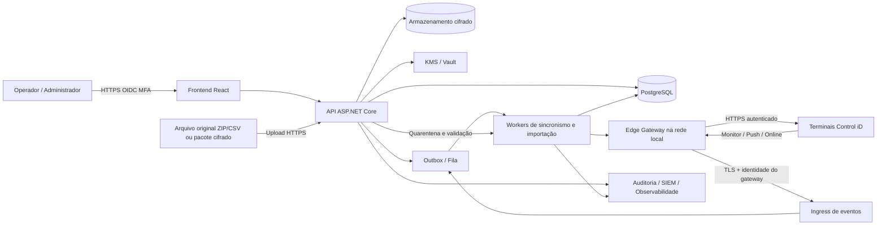
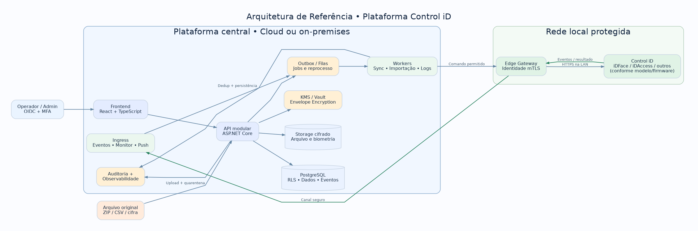

# Plataforma de Integração Control iD — Blueprint de Engenharia

**Versão do blueprint:** 1.0 · **Data:** 05/11/2026 · **Status:** especificação para implementação, **não** software implementado ou compatibilidade homologada.

## Estado da implementação

Em construção. Entregas em `docs/entregas/`; como rodar em `docs/runbooks/ambiente-local.md`. **Nenhum equipamento foi homologado** (`docs/capability-matrix/README.md`).

## Objetivo

Construir uma plataforma web segura, auditável, multiunidade e preparada para múltiplos clientes (tenants), com **PostgreSQL como banco operacional**, capaz de absorver e gerenciar dados dos equipamentos de **controle de acesso** Control iD tanto **pela API do equipamento** quanto **por arquivos exportados**, operar regras de acesso, acompanhar eventos, administrar dispositivos e produzir relatórios. O sistema deverá ser simples para operadores comuns, sem perder profundidade de administração.

> **Escopo verificado:** a documentação referenciada é a **API Linha de Acesso**, e não necessariamente todas as famílias de produtos Control iD (por exemplo, APIs de REP/ponto podem ser diferentes). 'Integração completa' significa cobrir todas as capacidades **expostas, relevantes e testadas** para cada modelo e firmware, e não prometer funções indisponíveis em um hardware. O desenvolvimento tem de manter uma **matriz de compatibilidade por dispositivo/firmware**.

## Recomendações executivas

1. **Stack:** ASP.NET Core sobre versão .NET LTS suportada no início do desenvolvimento (baseline proposta: .NET 10 LTS, a validar no ambiente) + PostgreSQL 16+ + React/TypeScript + Vite + TanStack Query + componentes acessíveis (Radix/shadcn) + Redis opcional + fila durável (RabbitMQ ou PostgreSQL outbox/queue para a primeira instalação) + S3 compatível/MinIO para blobs cifrados.
2. **Arquitetura:** *modular monolith* com workers e conectores de dispositivo isolados. Não começar com uma dúzia de microsserviços. Módulos: identidade/tenancy, cadastro, regras, dispositivos, sincronismo, ingestão de arquivos, eventos, autorização, relatórios, auditoria, chaves e operações.
3. **Conectividade:** **Edge Gateway** (agente instalado próximo dos equipamentos) para LANs sem acesso direto a partir do servidor; saída VPN/TLS. **Nunca expor a API administrativa da catraca/terminal na Internet**.
4. **Modo padrão:** **Standalone**, recomendado pelo fabricante, com sincronização de cadastros e políticas + Monitor para eventos. Pro opcional quando for necessária autorização online. Enterprise só com motor biométrico homologado e análise legal; **não basta receber uma imagem para identificar uma pessoa**.
5. **Sincronização:** estado desejado no PostgreSQL + reconciliador idempotente por equipamento + registros de aplicação e verificação; eventos via Monitor + *backfill* por `load_objects`, e Push conforme topologia. Arquivos entram na **mesma camada de normalização**, mas não são enviados de volta ao aparelho como um ZIP refeito.
6. **Importação criptografada:** TLS durante trânsito, criptografia autenticada AES-256-GCM em repouso e exportações, envelope encryption DEK/KEK, KMS/Vault, opção de pacote cifrado com senha (Argon2id) ou chave pública (HPKE implementado por biblioteca mantida). Upload em quarentena, antivírus, limites contra ZIP bomb, mapeamento, prévia e aprovação de *diff*.
7. **Biometria:** dado sensível; ativar o módulo apenas quando necessário, com política própria, acesso restrito, retenção curta, segregação de chaves e sem reexibir templates em telas comuns.
8. **Ação física:** abertura remota e mudanças que afetam segurança precisam de autorização própria, confirmação, motivo, trilha de auditoria, limites, rate limiting e dupla aprovação onde apropriado. A API pode confirmar o comando sem comprovar que a pessoa atravessou o portal.

## Desenho da solução

## Conteúdo do pacote

| Documento | Entregável |
|---|---|
| `docs/01-escopo-requisitos.md` | Escopo, perfis, RF, RNF, critérios de aceite |
| `docs/02-arquitetura.md` | Componentes, topologias, sincronização, decisões |
| `docs/03-catalogo-api.md` | Objetos, endpoints, matriz de cobertura e limitações |
| `docs/04-importacao.md` | Importação API/arquivos, criptografia, reconciliação e UX |
| `docs/05-dados.md` | Modelo lógico, regras SQL, retenção e performance |
| `docs/06-seguranca.md` | Ameaças, KMS, LGPD, proteção da API e operação física |
| `docs/07-ux.md` | Fluxos, telas, design system, erros e acessibilidade |
| `docs/08-qualidade.md` | Testes, SLIs/SLOs, carga, resiliência e entrega |
| `docs/09-plano-execucao.md` | Fases, épicos, dependências, DoR/DoD e prioridades |
| `docs/10-skills.md` | Skills reais e skills específicas propostas para agentes |
| `docs/11-operacao.md` | Runbooks, backups, reversão, incidentes e manutenção |
| `docs/12-contratos.md` | API interna, eventos, exemplos e semântica de erros |
| `docs/13-validacoes.md` | Questões que dependem de hardware, firmware e negócio |
| `docs/14-rastreabilidade.md` | Cobertura por origem e regra de homologação |
| `docs/15-prompt-construcao.md` | Instruções diretas para equipe ou agente de engenharia |
| `sql/001_init.sql` | Esquema inicial PostgreSQL executável como ponto de partida |
| `diagrams/*.mmd` | Diagramas Mermaid de arquitetura e sequência |
| `diagrams/arquitetura.png` | Arquitetura visual pronta para apresentar |
| `skills/*/SKILL.md` | Skills personalizadas para a implementação |
| `examples/` | Exemplos de manifesto cifrado e payloads |
| `AGENTS.md` | Regras do repositório para agentes de desenvolvimento |

## Restrições obrigatórias

- **Não** fazer acesso Control iD diretamente do browser; chamadas a equipamentos somente via servidor/Edge com TLS, ACL e sessão gerenciada.
- **Não** atribuir um mesmo ID de usuário do equipamento a pessoas diferentes no mesmo equipamento; usar ID interno UUID e tabela de vínculos por terminal.
- **Não** fazer merge automático por nome, nem apagar usuário porque faltou no arquivo.
- **Não** guardar segredo, PIN, senha de equipamento, payload biométrico ou URL com `?session=` em logs.
- **Não** aceitar arquivos gigantes sem limites de tamanho/tempo/compactação e sem verificação do conteúdo.
- **Não** enviar ZIP de backup alterado aos terminais: a Control iD alerta para não modificar manualmente seus formatos de exportação.
- **Não** prometer suporte a todos os modelos sem uma *suite* de testes por modelo/firmware.

## Bibliografia oficial e padrões

- Control iD API de Acesso: https://www.controlid.com.br/docs/access-api-pt/
- Objetos da API: https://www.controlid.com.br/docs/access-api-pt/objetos/lista-de-objetos/
- Importar/exportar: https://www.controlid.com.br/docs/access-api-pt/sistema/sincronizacao/
- Monitor: https://www.controlid.com.br/docs/access-api-pt/monitor/introducao-ao-monitor/
- Push: https://www.controlid.com.br/docs/access-api-pt/modo-push/introducao-ao-push/
- Modos: https://www.controlid.com.br/docs/access-api-pt/modos-de-operacao/introducao-aos-modos-de-operacao/
- Eventos online: https://www.controlid.com.br/docs/access-api-pt/modos-de-operacao/eventos-de-identificacao-online/
- Face: https://www.controlid.com.br/docs/access-api-pt/reconhecimento-facial/cadastro-facial/
- Hardening iDFace: https://www.controlid.com.br/manual/security-hardening-guide-en.pdf
- OWASP ASVS 5.0.0: https://asvs.owasp.org/
- OWASP Cryptographic Storage: https://cheatsheetseries.owasp.org/cheatsheets/Cryptographic_Storage_Cheat_Sheet.html
- OWASP File Upload: https://cheatsheetseries.owasp.org/cheatsheets/File_Upload_Cheat_Sheet.html
- ANPD, incidentes: https://www.gov.br/anpd/pt-br/canais_atendimento/agente-de-tratamento/comunicado-de-incidente-de-seguranca-cis
- Agent Skills spec: https://github.com/agentskills/agentskills

**Leitura obrigatória antes da primeira sprint:** `docs/13-validacoes.md`. O que não foi confirmado em equipamento real deve ficar rotulado como **proposta, a homologar**, inclusive SLA, licença de modo online, formato exato de CSV, mecanismos de TLS e suporte de cada endpoint.
